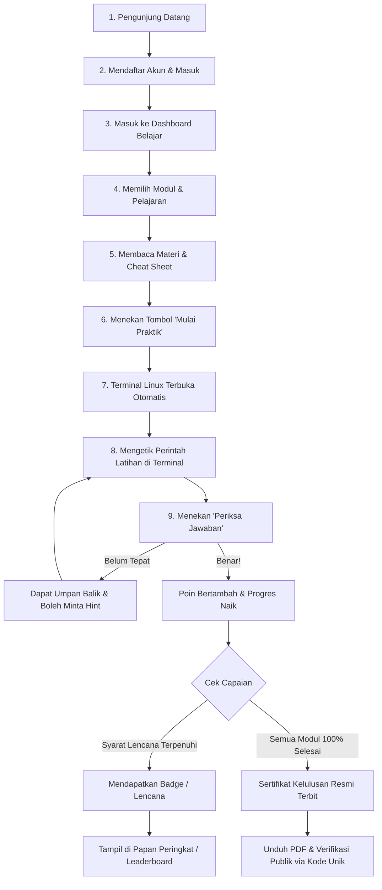

# 🐧 Panduan Lengkap LinuxLab

> **Selamat Datang di LinuxLab!**  
> Dokumen ini ditulis khusus agar siapa pun — mulai dari pemula, orang awam yang tidak memiliki latar belakang IT, mahasiswa, hingga pengembang profesional — dapat memahami konsep, cara kerja, arsitektur kode, dan teknologi di balik platform pembelajaran **LinuxLab**.

---

## 📑 Daftar Isi
1. [Apa itu LinuxLab? (Analogi Sederhana)](#1-apa-itu-linuxlab-analogi-sederhana)
2. [Alur Pengalaman Belajar (User Journey)](#2-alur-pengalaman-belajar-user-journey)
3. [Teknologi yang Digunakan (Tech Stack) & Alasannya](#3-teknologi-yang-digunakan-tech-stack--alasannya)
4. [Dapur Rahasia: Cara Kerja Terminal Nyata di Browser](#4-dapur-rahasia-cara-kerja-terminal-nyata-di-browser)
5. [Mesin Penilaian Otomatis (Bagaimana Jawaban Dinilai?)](#5-mesin-penilaian-otomatis-bagaimana-jawaban-dinilai)
6. [Struktur Folder & Peta Kode Program](#6-struktur-folder--peta-kode-program)
7. [Struktur Database (15 Tabel dan Fungsinya)](#7-struktur-database-15-tabel-dan-fungsinya)
8. [Aspek Keamanan (Mengapa Sistem Ini Aman?)](#8-aspek-keamanan-mengapa-sistem-ini-aman)
9. [Panduan Instalasi & Menjalankan Aplikasi dari Nol](#9-panduan-instalasi--menjalankan-aplikasi-dari-nol)
10. [Tanya Jawab Umum (FAQ untuk Orang Awam)](#10-tanya-jawab-umum-faq-untuk-orang-awam)

---

## 1. Apa itu LinuxLab? (Analogi Sederhana)

### Masalah yang Sering Dihadapi Pemula
Banyak orang ingin belajar sistem operasi **Linux** (sistem operasi yang digunakan oleh 90%+ server di seluruh dunia, internet, dan komputasi awan). Namun, pemula sering kali terbentur masalah:
- Takut salah ketik perintah yang bisa merusak komputer sendiri.
- Bingung cara memasang Linux di laptop (repot membagi partisi hard disk atau laptop terasa lambat bila menggunakan Virtual Machine).
- Belajar dari buku atau video saja sering terasa membosankan karena tidak ada praktik langsung dan tidak tahu apakah perintah yang diketik sudah benar atau belum.

### Solusi LinuxLab: "Simulator Mengemudi Mobil"
Bayangkan **LinuxLab** seperti **simulator mengemudi mobil**:
- Anda duduk di depan komputer biasa hanya dengan membuka peramban web (seperti Google Chrome atau Firefox).
- Di layar Anda, tersedia jalanan tiruan yang aman. Anda bebas menginjak gas, berbelok, bahkan jika Anda "menabrakkan mobil" sekalipun (mengetik perintah berbahaya seperti menghapus sistem), komputer asli Anda **100% aman** karena semua latihan berlangsung di dalam "kamar kaca terisolasi" yang dibuatkan khusus untuk Anda selama 30 menit.
- Ada "instruktur pintar" otomatis yang memeriksa tugas Anda: jika Anda diminta membuat file atau merapikan folder, sistem akan mengecek langsung ke dalam sistem tiruan tersebut dan memberikan nilai detik itu juga.

---

## 2. Alur Pengalaman Belajar (User Journey)

Bagaimana seorang murid belajar di LinuxLab dari awal hingga lulus?



### Penjelasan Tahapan:
1. **Daftar & Masuk**: Pengguna membuat akun dengan nama, username, email, dan kata sandi.
2. **Dashboard**: Menampilkan rangkuman kemajuan (berapa persen materi yang sudah dipelajari), peringkat saat ini, dan tombol instan *"Lanjutkan Belajar"*.
3. **Materi & Latihan**: Materi disusun bertingkat mulai dari dasar:
   - **Modul 1: File System** (berpindah folder, membuat file, melihat isi dokumen).
   - **Modul 2: Permission** (mengatur hak izin baca, tulis, dan eksekusi file).
   - **Modul 3: Text Processing** (mencari kata dengan `grep`, menyaring baris, dan teknik pipa/pipeline).
4. **Terminal Interaktif**: Begitu tombol *Mulai Praktik* ditekan, sebuah layar hitam terminal Linux asli muncul di sebelah materi.
5. **Penilaian Otomatis**: Murid menekan tombol *Periksa Jawaban*. Sistem langsung memeriksa kondisi terminal tanpa memuat ulang (refresh) halaman.
6. **Forum Diskusi**: Jika menemui jalan buntu, murid dapat bertanya di forum yang menempel langsung pada pelajaran tersebut. Penanya dapat memberikan tanda *"Jawaban Terbaik"* untuk jawaban yang paling membantu.
7. **Pencapaian & Sertifikat**: 
   - Murid mengumpulkan berbagai lencana pencapaian (*Badges*).
   - Jika menyelesaikan seluruh modul 100%, sistem menerbitkan **Sertifikat Kelulusan Resmi** berformat PDF lengkap dengan kode verifikasi unik (contoh: `LLAB-2026-X8K9LP`) yang dapat dicek keasliannya oleh siapa pun tanpa perlu login.

---

## 3. Teknologi yang Digunakan (Tech Stack) & Alasannya

LinuxLab dibangun dengan kombinasi teknologi modern kelas industri:

| Komponen | Teknologi | Peran & Mengapa Dipilih? |
|---|---|---|
| **Otak Aplikasi (Backend)** | **PHP 8.2+ & Laravel 11** | Laravel adalah kerangka kerja web paling populer di dunia PHP. Berperan mengatur logika pendaftaran, keamanan, database, kalkulasi nilai, dan berkomunikasi dengan container terminal. |
| **Wajah Aplikasi (Frontend)** | **Vue 3 + TypeScript** | Memberikan tampilan web interaktif, cepat, dan modern. TypeScript digunakan agar kode tidak mudah error karena tipe data diperiksa ketat sejak masa penulisan kode. |
| **Jembatan Antarmuka** | **Inertia.js** | Menghubungkan Laravel (backend) dan Vue (frontend) secara mulus. Kita mendapatkan kecepatan aplikasi satu halaman (Single Page Application) tanpa repot membuat REST API terpisah. |
| **Tampilan Terminal** | **xterm.js** | Komponen emulator terminal yang sama persis dengan yang digunakan di aplikasi terkenal seperti *Visual Studio Code*. Membuat browser web terasa seperti terminal Linux asli. |
| **Mesin Terminal Nyata** | **Docker Container** | Teknologi kontainerisasi ringan. Setiap murid yang latihan diberikan satu "kotak virtual Linux" tersendiri yang terisolasi total dari sistem utama. |
| **Jembatan Real-Time** | **WebSocket Gateway (Node.js)** | Mengalirkan ketikan huruf murid ke dalam kontainer dan mengembalikan teks output ke browser secara instan dalam hitungan milidetik. |
| **Basis Data** | **MySQL** | Menyimpan seluruh data akun, materi pelajaran, progres, riwayat latihan, forum, hingga sertifikat secara terstruktur dan aman. |
| **Pencetak Sertifikat** | **dompdf** | Mengubah template HTML yang rapi menjadi berkas dokumen PDF resmi yang dapat diunduh dan dicetak oleh pengguna. |

---

## 4. Dapur Rahasia: Cara Kerja Terminal Nyata di Browser

Banyak aplikasi edukasi di internet hanya melakukan "simulasi teks" (hanya mencocokkan kata yang diketik pengguna di kotak input). **LinuxLab berbeda**: pengguna benar-benar berinteraksi dengan sistem Linux sungguhan!

### Bagaimana jalurnya?

```
[Browser Siswa: xterm.js]
        │
        │ 1. Kirim ketikan huruf via WebSocket (Port 3001)
        ▼
[Terminal Gateway (Node.js di Server)]
        │
        │ 2. Cek keabsahan tiket/token ke Laravel internal (Port 8000)
        ▼
[Laravel Backend] ──> Token Valid? ──> Ya, izinkan!
        │
        ▼ 3. Sambungkan aliran data ke Docker
[Docker Container: linuxlab-session-xyz] (Menjalankan /bin/bash sebagai user 'student')
        │
        │ 4. Kembalikan hasil perintah (stdout/stderr)
        ▼
[Browser Siswa: xterm.js menampilkan output detik itu juga]
```

### Mengapa Sangat Cepat dan Real-time?
1. Saat halaman praktik dibuka, backend Laravel membuat satu container baru di Docker dan mencatat tiket akses unik (*ws_token*).
2. Browser menghubungkan kabel data dua arah (**WebSocket**) ke layanan kurir (*terminal-gateway.mjs*).
3. Setiap kali tombol keyboard ditekan, karakternya langsung dikirim ke shell Linux di dalam container, dan balasannya langsung digambar di layar browser murid.

---

## 5. Mesin Penilaian Otomatis (Bagaimana Jawaban Dinilai?)

Di balik tombol **"Periksa Jawaban"**, terdapat layanan pintar bernama `ValidationService`. Sistem ini tidak menilai dari apa yang diketik oleh murid di riwayat terminal, melainkan **menilai hasil nyata pekerjaan murid di dalam sistem Linux**:

### Tiga Jenis Metode Penilaian (`validation_type`):

1. **Pemeriksaan Kondisi Sistem (`system_state`)**
   - *Kapan digunakan?* Ketika latihan meminta murid membuat file, membuat folder, atau mengubah izin file.
   - *Contoh:* Latihan meminta membuat file `/home/student/data.txt` dengan izin akses `755`.
   - *Cara kerja:* Backend Laravel secara rahasia masuk ke container murid dan memeriksa:
     - Apakah filenya ada? (`file_exists`)
     - Apakah izin filenya benar `755`? (`file_permission`)
     - Apakah teks di dalamnya sesuai instruksi? (`file_contains`)

2. **Pemeriksaan Keluaran Perintah (`output`)**
   - *Kapan digunakan?* Ketika latihan meminta murid menampilkan hasil pencarian atau perhitungan teks.
   - *Contoh:* Latihan meminta menghitung jumlah baris yang memuat kata "linux".
   - *Cara kerja:* Backend mengeksekusi perintah pemeriksa resmi (yang ditentukan oleh guru/admin) dan mengecek apakah outputnya persis sesuai (`command_output_equals` atau `command_output_contains`).

3. **Pemeriksaan Gabungan (`combined`)**
   - Menggabungkan kedua syarat di atas. Seluruh pemeriksaan harus berhasil 100% agar dinyatakan benar.

---

## 6. Struktur Folder & Peta Kode Program

Bagi Anda yang ingin mempelajari atau mengembangkan kode sumber LinuxLab, berikut adalah peta jalan strukturnya:

```text
linuxlab/
├── app/
│   ├── Http/
│   │   ├── Controllers/            # Resepsionis: Menangani permintaan web dari pengguna
│   │   │   ├── Admin/              # Controller khusus Panel Administrator (CRUD materi & moderasi)
│   │   │   ├── Auth/               # Controller Login, Register, dan Profil
│   │   │   ├── CertificateController.php # Unduh dan verifikasi sertifikat
│   │   │   ├── ExerciseController.php    # Pemicu penilaian latihan dan pembuka hint
│   │   │   ├── ForumController.php       # Diskusi, tanya-jawab, upvote, best-answer
│   │   │   ├── LeaderboardController.php # Papan peringkat skor tertinggi
│   │   │   └── TerminalSessionController.php # Pembuat dan pengatur sesi terminal
│   │   └── Middleware/
│   │       └── EnsureUserIsAdmin.php # Satpam: Menolak user biasa masuk ke /admin
│   ├── Models/                     # Representasi 15 Tabel Database (Eloquent)
│   └── Services/                   # Otak Logika Utama Bisnis (Paling Penting!)
│       ├── TerminalService.php     # Mengontrol Docker (buat container, kirim perintah, hapus)
│       ├── ValidationService.php   # Mesin pemeriksa kebenaran jawaban latihan
│       ├── ProgressService.php     # Menghitung persentase kemajuan pelajaran & modul
│       ├── BadgeService.php        # Mengevaluasi apakah murid berhak mendapat lencana baru
│       └── CertificateService.php  # Menerbitkan sertifikat dengan nomor unik acak
├── bin/
│   └── terminal-gateway.mjs        # Daemon WebSocket: Jembatan browser ke Docker
├── config/
│   └── terminal.php                # Konfigurasi batas RAM, CPU, dan durasi sesi terminal
├── database/
│   ├── migrations/                 # Skrip cetak biru 15 tabel database MySQL
│   └── seeders/                    # Data awal (isi buku kurikulum, latihan awal, dan lencana)
├── resources/
│   ├── js/
│   │   ├── Components/             # Komponen visual (Terminal, ProgressBar, BadgeCard, Modal)
│   │   ├── Layouts/                # Kerangka tata letak (PublicLayout, UserLayout, AdminLayout)
│   │   └── Pages/                  # Halaman web lengkap (Dashboard, Practice, Forum, Leaderboard)
│   └── views/
│       └── certificates/pdf.blade.php # Desain visual sertifikat kelulusan saat dicetak ke PDF
├── routes/
│   └── web.php                     # Daftar seluruh alamat URL aplikasi
└── SPEC.md                         # Sumber Kebenaran (Spesifikasi Teknis Lengkap Proyek)
```

---

## 7. Struktur Database (15 Tabel dan Fungsinya)

Seluruh informasi LinuxLab tersimpan secara terstruktur di database MySQL pada **15 tabel utama**:

| No | Nama Tabel | Peran Sederhana |
|:---:|---|---|
| 1 | `users` | Menyimpan data akun pengguna dan administrator (beserta peran `role`). |
| 2 | `modules` | Daftar tema besar belajar (Modul 1: File System, Modul 2: Permission, dsb). |
| 3 | `lessons` | Bab pelajaran yang ada di dalam setiap modul (berisi teks teori & cheat sheet). |
| 4 | `exercises` | Soal latihan praktik yang ada di dalam bab pelajaran beserta aturan penilaiannya. |
| 5 | `hints` | Petunjuk bertahap untuk membantu murid jika kesulitan menjawab latihan. |
| 6 | `terminal_sessions` | Catatan container aktif milik siapa, kapan dibuat, dan kapan kedaluwarsa. |
| 7 | `exercise_attempts` | Buku riwayat: mencatat setiap penekanan tombol periksa, nilai, dan umpan baliknya. |
| 8 | `lesson_progress` | Status apakah bab pelajaran sudah *belum mulai*, *sedang berjalan*, atau *selesai*. |
| 9 | `module_progress` | Angka persentase penyelesaian modul (misal: Modul 1 sudah 100%). |
| 10 | `badges` | Daftar master medali/lencana penghargaan yang bisa didapatkan. |
| 11 | `user_badges` | Catatan lencana apa saja yang sudah berhasil dikoleksi oleh murid. |
| 12 | `questions` | Pertanyaan forum yang diajukan oleh murid pada pelajaran tertentu. |
| 13 | `answers` | Jawaban dan panduan dari murid lain atau admin di forum diskusi. |
| 14 | `answer_votes` | Catatan upvote (jempol) pada jawaban forum (1 akun hanya bisa 1 vote). |
| 15 | `certificates` | Sertifikat resmi yang diterbitkan untuk murid yang lulus seluruh modul. |

---

## 8. Aspek Keamanan (Mengapa Sistem Ini Aman?)

Menjalankan terminal Linux di web terdengar berisiko jika tidak dirancang dengan benar. Oleh karena itu, LinuxLab menerapkan standar keamanan berlapis yang sangat ketat:

1. **Docker Daemon Tidak Pernah Dibuka ke Luar**  
   Pengguna atau peretas dari browser tidak memiliki akses apa pun ke file soket Docker host. Hanya server Laravel internal yang memiliki hak memerintah Docker.
2. **Kamar Mandiri (Isolasi 1:1)**  
   Satu pengguna mendapatkan satu kontainer sendiri. Pengguna A tidak akan pernah bisa melihat atau mencampuri sistem pengguna B.
3. **Tanpa Akses Internet (`--network none`)**  
   Kontainer latihan tidak memiliki koneksi internet. Pengguna tidak bisa menyalahgunakan kontainer untuk menyerang situs web lain atau mengunduh konten berbahaya.
4. **Batas Sumber Daya Komputer**  
   Setiap kontainer dibatasi ketat: hanya boleh memakai maksimal 0.5 core prosesor (CPU) dan RAM maksimal 256 MB. Pengguna tidak dapat membuat server utama hang atau kehabisan memori.
5. **Bukan Pengguna Root**  
   Di dalam kontainer, pengguna masuk sebagai user biasa bernama `student`, bukan penguasa tertinggi (`root`).
6. **Penghancuran Otomatis (Self-Destruct)**  
   Sesi latihan memiliki batas waktu (30 menit). Ketika murid menutup browser atau waktu habis, kontainer langsung **dihancurkan dan seluruh filenya dibuang**.

---

## 9. Panduan Instalasi & Menjalankan Aplikasi dari Nol

Jika Anda ingin menjalankan aplikasi LinuxLab di laptop atau server Anda sendiri, ikuti langkah berikut:

### Kebutuhan Perangkat (Prerequisites)
- Sistem Operasi: Linux (disarankan Ubuntu/Debian) atau macOS.
- **PHP 8.2** atau lebih baru (beserta ekstensi `pdo_mysql`, `mbstring`, `gd`).
- **Composer** (manajer paket PHP).
- **Node.js 18+** & **npm**.
- **MySQL 8.0+** atau MariaDB.
- **Docker** terpasang dan service-nya aktif.

---

### Langkah 1: Kloning Repositori & Pasang Dependensi
Buka terminal Anda dan jalankan:
```bash
# Masuk ke folder proyek
cd /home/masapis/linuxlab

# Pasang paket pustaka backend PHP
composer install

# Pasang paket pustaka frontend JavaScript
npm install
```

---

### Langkah 2: Konfigurasi File Lingkungan (`.env`)
Salin file konfigurasi contoh:
```bash
cp .env.example .env
php artisan key:generate
```
Buka file `.env` dan pastikan konfigurasi database serta terminal sesuai:
```ini
APP_NAME=LinuxLab
APP_URL=http://127.0.0.1:8000

DB_CONNECTION=mysql
DB_HOST=127.0.0.1
DB_PORT=3306
DB_DATABASE=linuxlab
DB_USERNAME=root
DB_PASSWORD=rahasia_anda

# Konfigurasi Terminal
TERMINAL_IMAGE=linuxlab-terminal:latest
TERMINAL_CPU_LIMIT=0.5
TERMINAL_MEMORY_LIMIT=256m
TERMINAL_SESSION_TTL=30
TERMINAL_MAX_SESSIONS=10
TERMINAL_WS_PORT=3001
TERMINAL_GATEWAY_SECRET=rahasia_acak_anda  # wajib diisi acak (openssl rand -hex 32); auth gateway
```

---

### Langkah 3: Bangun Image Docker untuk Terminal
Siapkan sistem Linux mini yang akan digunakan oleh murid saat latihan:
```bash
docker build -t linuxlab-terminal:latest docker/terminal/
```

---

### Langkah 4: Migrasi Database & Isi Data Awal
Bangun 15 tabel dan masukkan kurikulum pembelajaran serta lencana awal:
```bash
php artisan migrate --seed
```
*(Perintah ini akan membuat akun admin awal, 3 modul lengkap, 9 pelajaran, 18 latihan, dan 7 lencana).*

---

### Langkah 5: Bangun Tampilan Frontend
```bash
npm run build
```

---

### Langkah 6: Jalankan Layanan Aplikasi
Untuk menjalankan sistem secara utuh pada tahap pengembangan, buka 3 tab terminal:

- **Tab 1: Server Web Laravel**
  ```bash
  php artisan serve
  ```
  *(Aplikasi web kini dapat dibuka di browser pada alamat `http://127.0.0.1:8000`)*

- **Tab 2: Kurir WebSocket Terminal Gateway**
  ```bash
  node bin/terminal-gateway.mjs
  ```
  *(Jembatan terminal aktif di port 3001; secret dibaca otomatis dari `TERMINAL_GATEWAY_SECRET` di `.env`, tidak perlu export manual)*

- **Tab 3: Pembersih Sesi Kedaluwarsa Otomatis (Opsional / Background)**
  ```bash
  php artisan terminal:clean-expired
  ```

---

### Cara Menjalankan Pengujian Otomatis
Untuk memastikan seluruh fitur dan keamanan berfungsi dengan sempurna:
```bash
php artisan test
```
*Hasil yang diharapkan: 100 tests passed, 575 assertions sukses tanpa error.*

---

## 10. Tanya Jawab Umum (FAQ untuk Orang Awam)

#### Q: Jika saya mengetik perintah `rm -rf /*` (perintah pemusnah file) di terminal LinuxLab, apakah laptop saya rusak?
> **Jawab:** **Sama sekali tidak!** Perintah tersebut hanya akan menghapus file di dalam kontainer virtual tiruan yang memang dibuatkan khusus untuk Anda. Sistem operasi komputer asli Anda maupun server web LinuxLab tidak akan tersentuh sedikit pun.

#### Q: Mengapa file latihan yang saya buat kemarin hilang saat saya login lagi hari ini?
> **Jawab:** Ini adalah fitur keamanan dan pembelajaran (*non-persistent*). Setiap kali Anda memulai sesi praktik baru, sistem selalu menyediakan lingkungan yang baru, bersih, dan segar agar Anda dapat berlatih dari awal tanpa terganggu sisa latihan sebelumnya.

#### Q: Apakah orang lain bisa memalsukan sertifikat kelulusan LinuxLab?
> **Jawab:** **Tidak bisa.** Setiap sertifikat yang dicetak memiliki kode acak unik (seperti `LLAB-2026-AB12CD`). Siapa pun (termasuk perekrut kerja atau guru) dapat memasukkan kode tersebut di menu *Verifikasi Sertifikat* publik untuk mencocokkan nama penerima asli dan tanggal kelulusannya langsung dari database utama.

#### Q: Apakah aplikasi ini berbayar atau ada langganan?
> **Jawab:** Pada versi 1 (v1) ini, LinuxLab dirancang sebagai platform pembelajaran mandiri gratis dan nirlaba untuk membantu pemula memahami dasar-dasar Linux.

---

*LinuxLab — Dibuat untuk menghadirkan pengalaman belajar Linux yang mudah, interaktif, dan aman bagi siapa saja.*
