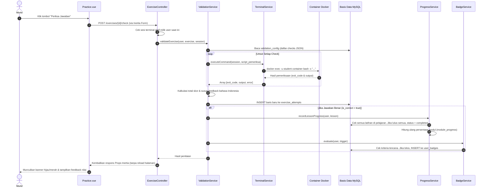
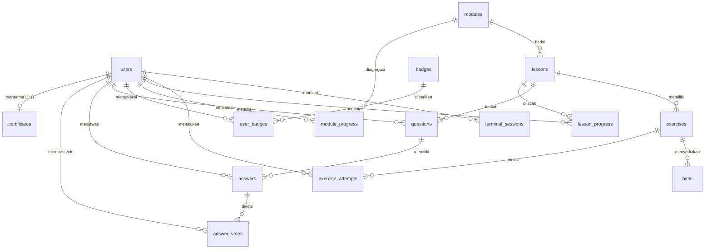

# 🛠️ Dokumentasi Teknis & Arsitektur Kode LinuxLab

> **Buku Panduan Teknis untuk Pengembang & Mahasiswa:**  
> Dokumen ini menjelaskan **mengapa kode LinuxLab dirancang seperti ini**, **di mana setiap bagian kode berada**, **bagaimana aliran data berjalan dari frontend ke backend hingga ke dalam container**, serta alasan arsitektural di balik setiap keputusan rekayasa perangkat lunak.

---

## 📑 Daftar Isi
1. [Filosofi Arsitektur: "Kenapa Kodenya Begini?"](#1-filosofi-arsitektur-kenapa-kodenya-begini)
2. [Peta & Letak Kode Backend (`app/`)](#2-peta--letak-kode-backend-app)
3. [Dapur Logika: Service Layer (`app/Services/`)](#3-dapur-logika-service-layer-appservices)
4. [Peta & Letak Kode Frontend (`resources/js/`)](#4-peta--letak-kode-frontend-resourcesjs)
5. [Integrasi Terminal: xterm.js dan WebSocket Gateway](#5-integrasi-terminal-xtermjs-dan-websocket-gateway)
6. [Alur Data dari Ujung ke Ujung (End-to-End Walkthrough)](#6-alur-data-dari-ujung-ke-ujung-end-to-end-walkthrough)
7. [Struktur Model & Basis Data (Eloquent & Migrations)](#7-struktur-model--basis-data-eloquent--migrations)
8. [Keamanan & Isolasi (Security Deep-Dive)](#8-keamanan--isolasi-security-deep-dive)
9. [Kamus Istilah Teknis untuk Pemula](#9-kamus-istilah-teknis-untuk-pemula)

---

## 1. Filosofi Arsitektur: "Kenapa Kodenya Begini?"

Saat membaca proyek perangkat lunak, pertanyaan terpenting seorang developer pemula bukanlah *"apa kodenya?"*, melainkan *"mengapa ditulis dengan cara ini?"*. Berikut adalah pertimbangan rekayasa di balik keputusan LinuxLab:

### A. Mengapa Memakai Inertia.js (Bukan REST API Terpisah / Murni SPA)?
- **Masalah pada Arsitektur Tradisional (Frontend & Backend Terpisah):**  
  Jika kita membuat backend Laravel murni REST API dan frontend Vue secara terpisah, kita harus:
  1. Menulis rute dua kali (di Laravel dan di Vue Router).
  2. Mengelola token otentikasi rumit (JWT, refresh token, penyimpanan di cookies/localStorage).
  3. Menulis transformer data (API Resource) untuk setiap permintaan.
  4. Menangani status loading dan error secara manual di kedua sisi.
- **Solusi Inertia.js:**  
  Inertia bertindak sebagai jembatan langsung. Controller Laravel merender halaman Vue dengan mengirimkan data langsung sebagai **Props**.
  - Pengguna merasakan kecepatan dan kelancaran Single Page Application (tanpa reload putih saat berpindah halaman).
  - Keamanan tetap dipegang penuh oleh sesi bawaan Laravel (CSRF protection otomatis, cookie HTTP-only).
  - Produktivitas meningkat pesat karena backend dan frontend berada dalam satu repositori (*monolith modern*).

---

### B. Mengapa Menggunakan Service Layer (Bukan Semua Ditaruh di Controller)?
- **Masalah Fat Controller:**  
  Banyak programmer pemula menaruh seluruh logika (penilaian, manipulasi Docker, kalkulasi ranking, pemberian badge) langsung di dalam `Controller`. Akibatnya, controller membengkak ribuan baris, sulit dibaca, dan mustahil diuji secara terpisah (*unit test*).
- **Pendekatan Clean Architecture LinuxLab:**  
  Controller hanya bertindak sebagai **resepsionis**:
  1. Menerima request HTTP dari browser.
  2. Memeriksa validasi input.
  3. Memanggil **Service** yang bertanggung jawab atas logika bisnis.
  4. Mengembalikan respons (redirect atau JSON).
- Seluruh logika berat dipindahkan ke folder `app/Services/`:
  - `TerminalService`: Khusus mengurus Docker.
  - `ValidationService`: Khusus mengurus penilaian jawaban.
  - `ProgressService`: Khusus mengurus kalkulasi persentase kelulusan.
  - `BadgeService`: Khusus mengevaluasi kelayakan lencana.
  - `CertificateService`: Khusus membuat kode unik dan mencetak sertifikat.

---

### C. Mengapa WebSocket Gateway Menggunakan Node.js Terpisah (`bin/terminal-gateway.mjs`)?
- **Karakteristik PHP:**  
  PHP (terutama PHP-FPM) dirancang dengan model eksekusi *short-lived request-response*: request masuk $\rightarrow$ PHP bangun $\rightarrow$ eksekusi dalam hitungan milidetik $\rightarrow$ respons dikirim $\rightarrow$ proses selesai dan mati.
- **Kebutuhan Terminal Interaktif:**  
  Terminal membutuhkan koneksi pipa dua arah yang **hidup terus menerus** (*long-running persistent stream*). Setiap kali pengguna menekan satu huruf (misalnya huruf `l`), huruf itu harus langsung dikirim ke shell Linux, dan outputnya dipantulkan kembali dengan latensi di bawah 10 milidetik.
- **Solusi:**  
  Sebuah daemon Node.js kecil (`bin/terminal-gateway.mjs`) dijalankan di port `3001`.
  - Node.js menggunakan arsitektur *non-blocking event loop* yang sempurna untuk menangani ribuan aliran teks dua arah secara real-time.
  - **Penting:** Gateway ini **tidak memiliki akses langsung** untuk membuat container. Ia hanya menjadi kurir yang memverifikasi token sesi ke Laravel via URL lokal `http://127.0.0.1:8000/internal/terminal/verify` (cek IP loopback + header rahasia `X-Gateway-Secret` yang dibaca otomatis dari `TERMINAL_GATEWAY_SECRET` di `.env`) sebelum menyambungkan browser ke PTY container. ID container divalidasi pola aman sebelum dipakai dan token tidak pernah ditulis ke log.

---

### D. Mengapa Penilaian Memeriksa Kondisi Sistem, Bukan Riwayat Perintah Bash?
- **Kesalahan Umum Platform Belajar:**  
  Banyak platform pemula memeriksa jawaban dengan membaca file `.bash_history` atau memeriksa apakah pengguna mengetik `mkdir latihan`.
- **Kelemahan Cara Tersebut:**  
  Di Linux, ada puluhan cara untuk mencapai tujuan yang sama:
  - Membuat file bisa memakai `touch file.txt`, `echo "" > file.txt`, `cat << EOF > file.txt`, atau editor teks seperti `nano`.
  - Jika kita memeriksa perintah yang diketik, murid yang kreatif atau memiliki cara lain akan disalahkan.
- **Cara LinuxLab (`ValidationService`):**  
  Sistem menilai **kondisi nyata sistem (System State)**:
  - Apakah file `/home/student/latihan/hello.txt` benar-benar ada di dalam container?
  - Apakah hak akses file tersebut bernilai `755`?
  - Apakah teks di dalam file memuat kata yang diminta?  
  Ini meniru cara kerja pengujian perangkat lunak di dunia profesional (*test-driven validation*).

---

## 2. Peta & Letak Kode Backend (`app/`)

Semua logika server ditulis menggunakan bahasa PHP modern dengan kerangka kerja Laravel 11.

```
app/
├── Console/
│   └── Commands/
│       └── CleanExpiredTerminalSessions.php # Perintah CLI untuk membersihkan container kedaluwarsa
├── Http/
│   ├── Controllers/
│   │   ├── Admin/                           # Controller khusus panel Admin (awalan /admin)
│   │   │   ├── AdminDashboardController.php # Statistik riil (total user, modul, latihan, forum)
│   │   │   ├── AdminModuleController.php    # CRUD tema besar modul
│   │   │   ├── AdminLessonController.php    # CRUD bab pelajaran
│   │   │   ├── AdminExerciseController.php  # CRUD latihan & editor JSON validator
│   │   │   ├── AdminHintController.php      # CRUD petunjuk bertahap latihan
│   │   │   ├── AdminBadgeController.php     # CRUD master lencana & kriteria
│   │   │   ├── AdminForumController.php     # Moderasi forum (hapus tanya/jawab + cascade)
│   │   │   └── AdminUserController.php      # Daftar pengguna & toggle nonaktifkan akun
│   │   ├── Auth/                            # Otentikasi (Breeze scaffold)
│   │   │   ├── AuthenticatedSessionController.php # Login & Logout (sesi Laravel)
│   │   │   └── RegisteredUserController.php       # Registrasi akun baru
│   │   ├── AchievementController.php        # Menampilkan koleksi lencana & status sertifikat
│   │   ├── CertificateController.php        # Unduh PDF (dompdf) & halaman verifikasi publik
│   │   ├── DashboardController.php          # Dashboard murid & tombol "Lanjutkan Belajar"
│   │   ├── ExerciseController.php           # Endpoint periksa jawaban & permintaan hint
│   │   ├── ForumController.php              # Thread tanya-jawab, upvote, dan tandai best answer
│   │   ├── LeaderboardController.php        # Perhitungan ranking publik (agregasi skor unik)
│   │   ├── LessonController.php             # Halaman materi teks, cheat sheet, & halaman praktik
│   │   ├── ModuleController.php             # Daftar modul publik & persentase capaian
│   │   ├── ProfileController.php            # Edit nama dan kata sandi sendiri
│   │   └── TerminalSessionController.php    # API internal pembuka/penutup sesi container
│   └── Middleware/
│       ├── EnsureUserIsAdmin.php            # RBAC: Memeriksa role === 'admin' (tolak 403 jika bukan)
│       └── HandleInertiaRequests.php        # Membagikan data global ke Vue (auth.user & flash banner)
├── Models/                                  # 15 Model Eloquent (Representasi Tabel Database)
└── Services/                                # 5 Service Utama (Dapur Logika Bisnis)
```

---

## 3. Dapur Logika: Service Layer (`app/Services/`)

Berikut rincian dari kelima berkas *Service* yang menjadi jantung kecerdasan LinuxLab:

### 1. `TerminalService.php`
- **Tanggung Jawab:** Berkomunikasi dengan mesin Docker host melalui pustaka `Symfony\Component\Process\Process`.
- **Fungsi Kunci:**
  - `createSession(User $user, ?int $exerciseId)`:
    - Memeriksa batas kuota server (`TERMINAL_MAX_SESSIONS`) di dalam transaksi dengan kunci baris user (anti-balapan pembuatan sesi ganda), plus throttle rate-limit di route.
    - Memastikan satu murid hanya punya 1 sesi aktif (menutup sesi lama jika ada).
    - Menjalankan `docker run` dengan parameter isolasi ketat: `--cpus 0.5`, `-m 256m`, `--pids-limit 64`, `--network none`, `--cap-drop ALL`, `--security-opt no-new-privileges:true`, `--user student`, `-w /home/student`.
    - Membuat baris di database `terminal_sessions` lengkap dengan `ws_token` sepanjang 64 karakter acak.
  - `destroySession(TerminalSession $session)`: Menjalankan `docker rm -f <container_id>` dan mengubah status menjadi `terminated`/`expired`.
  - `executeCommand(TerminalSession $session, string $command)`: Menjalankan perintah evaluasi di dalam kontainer murid (`docker exec -u student ...`) dan menangkap kode keluaran (*exit code*), stdout, dan stderr.
  - `cleanExpiredSessions()`: Mencari sesi yang `expires_at <= now()` dan menghancurkan kontainernya secara massal.

### 2. `ValidationService.php`
- **Tanggung Jawab:** Menilai apakah pekerjaan murid di dalam kontainer sudah benar.
- **Format Evaluasi (`validation_config`):** Berkas JSON yang memuat daftar pemeriksaan (*checks*):
  ```json
  {
    "checks": [
      { "type": "file_exists", "path": "/home/student/latihan/hello.txt" },
      { "type": "file_permission", "path": "/home/student/latihan/run.sh", "mode": "755" },
      { "type": "command_output_equals", "command": "grep -c 'linux' /home/student/kata.txt", "text": "3" }
    ]
  }
  ```
- **Fungsi Kunci:**
  - `validateExercise(User $user, Exercise $exercise, ?TerminalSession $session)`:
    - Mengecek apakah murid memiliki sesi terminal aktif (menolak jika belum ada sesi).
    - Menjalankan setiap *check* satu per satu ke dalam kontainer melalui `TerminalService`.
    - Menghitung skor: Jika semua *check* lulus, murid mendapat nilai penuh (`exercise.points`). Jika ada yang gagal, nilai `0` (kecuali diatur `"partial": true`).
    - Menyusun umpan balik ramah pemula dalam bahasa Indonesia.
    - Mencatat hasil ke tabel `exercise_attempts`.
    - Jika jawaban benar, memicu `ProgressService` untuk menaikkan progres belajar.

### 3. `ProgressService.php`
- **Tanggung Jawab:** Mengkalkulasi kemajuan belajar murid.
- **Aturan Bisnis:**
  - Bab pelajaran dinyatakan `completed` jika **seluruh latihan wajib** pada bab tersebut sudah dijawab benar minimal satu kali.
  - Persentase modul dihitung dari:  
    $$\text{Persentase} = \left( \frac{\text{Jumlah Pelajaran Selesai}}{\text{Total Pelajaran dalam Modul}} \right) \times 100\%$$
  - Jika modul mencapai 100%, statusnya berubah menjadi `completed`, memicu evaluasi lencana kelulusan modul di `BadgeService` dan memeriksa syarat sertifikat di `CertificateService`.

### 4. `BadgeService.php`
- **Tanggung Jawab:** Memeriksa apakah tindakan murid memicu perolehan lencana (*achievement*).
- **Jenis Kriteria yang Didukung:**
  - `first_exercise`: Diberikan saat pertama kali menjawab benar latihan apa pun.
  - `lesson_completed`: Diberikan saat bab pelajaran tertentu selesai.
  - `module_completed`: Diberikan saat suatu modul mencapai 100%.
  - `exercises_count`: Diberikan saat menyelesaikan $n$ latihan berbeda.
  - `first_question`: Diberikan saat pertama kali mengirim pertanyaan di forum.
  - `best_answer`: Diberikan saat jawaban murid dipilih sebagai jawaban terbaik oleh penanya.
- Menjamin setiap lencana hanya dapat diperoleh **satu kali** oleh satu pengguna (`UNIQUE(user_id, badge_id)`).

### 5. `CertificateService.php`
- **Tanggung Jawab:** Menerbitkan dan memverifikasi sertifikat kelulusan.
- **Aturan Penerbitan:**
  - Diterbitkan secara otomatis tepat saat seorang murid menyelesaikan 100% dari **seluruh modul yang dipublikasikan**.
  - Mengunci nama penerima sesuai `users.name` saat itu dan menghasilkan kode unik acak dengan format:  
    `LLAB-<tahun>-<6 karakter alfanumerik acak>` (contoh: `LLAB-2026-X9K2P1`).
  - Menyediakan template HTML di `resources/views/certificates/pdf.blade.php` untuk diubah menjadi dokumen PDF resmi oleh pustaka `dompdf`.

---

## 4. Peta & Letak Kode Frontend (`resources/js/`)

Frontend dibangun menggunakan **Vue 3 (Composition API)** dengan bahasa **TypeScript** dan penataan gaya menggunakan **Tailwind CSS**.

```
resources/js/
├── app.ts                  # Entry point aplikasi: inisialisasi Inertia, Vue, dan konfigurasi tema
├── types/                  # Definisi antarmuka TypeScript (User, Module, Lesson, Exercise, Badge)
├── Layouts/                # Kerangka Pembungkus Halaman
│   ├── PublicLayout.vue    # Layout publik (Navbar ringkas + Footer) untuk Home, Leaderboard, Verify
│   ├── UserLayout.vue      # Layout murid (Navbar dengan ringkasan progres, foto profil, navigasi belajar)
│   └── AdminLayout.vue     # Layout admin (Sidebar gelap, menu manajemen, banner alert flash)
├── Components/             # Komponen UI Reusable (Balok Lego)
│   ├── Terminal.vue        # Emulator Terminal berbasis xterm.js
│   ├── ProgressBar.vue     # Bilah persentase kemajuan (0-100%)
│   ├── BadgeCard.vue       # Kartu visual lencana (terbuka vs terkunci)
│   ├── EmptyState.vue      # Tampilan ramah saat daftar kosong (misal: belum ada pertanyaan)
│   ├── AppButton.vue       # Tombol seragam (Primary, Secondary, Danger)
│   ├── AppCard.vue         # Kartu kontainer bergaya modern
│   ├── FormInput.vue       # Kotak input formulir lengkap dengan pesan error
│   └── Modal.vue           # Jendela dialog pop-up
└── Pages/                  # Halaman Penuh yang Dikirim oleh Controller
    ├── Welcome.vue         # Halaman muka publik (Hero section & pengenalan modul)
    ├── Dashboard.vue       # Dashboard murid (Progres keseluruhan & tombol Lanjutkan Belajar)
    ├── Modules/
    │   ├── Index.vue       # Katalog seluruh modul pembelajaran
    │   └── Show.vue        # Detail modul dan daftar bab pelajaran di dalamnya
    ├── Lessons/
    │   ├── Show.vue        # Halaman baca materi teks, contoh perintah, dan cheat sheet
    │   └── Practice.vue    # Halaman Praktik (Split-Screen: Panduan Latihan & Terminal)
    ├── Progress/
    │   └── Index.vue       # Rangkuman kemajuan belajar & riwayat percobaan latihan
    ├── Achievements/
    │   └── Index.vue       # Galeri lencana & kartu sertifikat kelulusan
    ├── Leaderboard/
    │   └── Index.vue       # Papan peringkat publik seluruh pengguna
    ├── Certificates/
    │   └── Verify.vue      # Halaman verifikasi publik keaslian sertifikat
    ├── Forum/
    │   ├── Index.vue       # Daftar pertanyaan forum per bab pelajaran
    │   └── Show.vue        # Halaman detail diskusi, penulisan jawaban, & voting
    └── Admin/              # Halaman-halaman panel administrator
        ├── Dashboard.vue   # Ringkasan analitik data riil
        ├── Modules/        # Manajemen modul
        ├── Lessons/        # Manajemen bab pelajaran
        ├── Exercises/      # Manajemen soal & konfigurasi JSON penilaian
        ├── Badges/         # Manajemen lencana
        ├── Forum/          # Panel moderasi konten tidak pantas
        └── Users/          # Manajemen status aktif pengguna
```

---

## 5. Integrasi Terminal: xterm.js dan WebSocket Gateway

Bagian ini adalah fitur paling istimewa dari LinuxLab: bagaimana browser dapat menjalankan terminal interaktif.

### Komponen Frontend: `resources/js/Components/Terminal.vue`
1. **Inisialisasi xterm.js:**  
   Saat komponen dimuat di layar (`onMounted`), instans `Terminal` dari xterm.js dibuat dengan tema gelap (*dark mode*) dan font monospace yang nyaman.
2. **Addon Fit:**  
   Menggunakan `@xterm/addon-fit` agar ukuran baris dan kolom terminal otomatis menyesuaikan ukuran jendela browser murid (responsif di laptop dan monitor besar).
3. **Koneksi WebSocket:**  
   Komponen membuka koneksi WebSocket ke URL:  
   `ws://127.0.0.1:3001/ws/terminal?token=<ws_token>`
4. **Penanganan Aliran Data:**
   - **Dari Keyboard ke Server:** Setiap tombol yang ditekan murid ditangkap oleh event `terminal.onData(...)` dan dikirimkan mentah ke WebSocket.
   - **Dari Server ke Layar:** Setiap byte teks yang diterima dari WebSocket langsung ditulis ke layar menggunakan `terminal.write(...)`.
   - **Event Resize:** Jika ukuran layar berubah, komponen mengirimkan JSON kecil `{"type":"resize", "cols": 80, "rows": 24}` agar shell di kontainer menyesuaikan ukuran jendela (`stty cols 80 rows 24`).

### Komponen Gateway: `bin/terminal-gateway.mjs`
1. Berjalan di Node.js pada port `3001`.
2. Saat ada koneksi baru masuk, gateway membedah parameter `?token=...`.
3. Gateway menghubungi Laravel internal: `http://127.0.0.1:8000/internal/terminal/verify?token=...`.
4. Jika Laravel menjawab **valid**, gateway menjalankan perintah lokal:
   ```bash
   script -qec "docker exec -it -e TERM=xterm-256color <container_id> /bin/bash" /dev/null
   ```
   *(Perintah `script` digunakan untuk mengalokasikan Pseudo-Terminal / PTY nyata di Linux agar fitur seperti tombol panah riwayat perintah, warna teks bash, dan tab autocompletion berfungsi sempurna).*
5. Begitu koneksi WebSocket terputus (murid menutup tab), gateway langsung membunuh proses shell tersebut (`SIGHUP`).

---

## 6. Alur Data dari Ujung ke Ujung (End-to-End Walkthrough)

Mari kita telusuri apa yang terjadi di dalam kode saat seorang murid menekan tombol **"Periksa Jawaban"**:



---

## 7. Struktur Model & Basis Data (Eloquent & Migrations)

Aplikasi memiliki **15 tabel domain** yang didefinisikan secara presisi pada `database/migrations/` dan dihubungkan melalui Eloquent ORM di `app/Models/`:



### Relasi dan Aturan Integritas Penting:
1. **Cascade Delete (Penghapusan Berantai):**  
   Jika admin menghapus satu Modul, maka seluruh Pelajaran, Latihan, dan Hint di bawah modul tersebut otomatis ikut terhapus di tingkat basis data (`onDelete('cascade')`).
2. **Perlindungan Data Forum:**  
   Jika seorang pengguna dihapus/dinonaktifkan, pertanyaan dan jawaban forum yang pernah ia tulis **tidak ikut terhapus** demi menjaga kesinambungan diskusi pembelajaran bagi murid lain.
3. **Pencegahan Kecurangan Upvote:**  
   Tabel `answer_votes` memiliki indeks unik ganda `UNIQUE(answer_id, user_id)`. Artinya, mustahil seorang pengguna melakukan spam upvote berkali-kali pada jawaban yang sama karena akan langsung ditolak oleh MySQL.
4. **Keunikan Sertifikat:**  
   Kolom `certificates.user_id` bersifat unik (`UNIQUE`). Satu pengguna hanya dapat memiliki tepat satu sertifikat kelulusan seumur hidup akunnya.

---

## 8. Keamanan & Isolasi (Security Deep-Dive)

Sebagai platform yang mengeksekusi perintah shell Linux dari pengguna internet, LinuxLab menerapkan prinsip *Defense-in-Depth* (Pertahanan Berlapis):

| Vektor Serangan Potensial | Cara LinuxLab Mencegahnya | Bukti Kode Implementasi |
|---|---|---|
| **Akses Ilegal ke Docker Host** | Docker daemon tidak pernah dibuka ke jaringan publik. Akses hanya melalui PHP internal. Gateway verifikasi memblokir IP selain `127.0.0.1`. | [`TerminalSessionController.php#L112`](file:///home/masapis/linuxlab/app/Http/Controllers/TerminalSessionController.php#L112) |
| **Pencurian Sesi Antar Murid** | Setiap endpoint terminal dan penilaian memverifikasi bahwa ID pemilik sesi sama dengan ID pengguna yang sedang login (`abort_unless($session->user_id === Auth::id(), 403)`). | [`TerminalSessionController.php#L64`](file:///home/masapis/linuxlab/app/Http/Controllers/TerminalSessionController.php#L64), [`ExerciseController.php#L29`](file:///home/masapis/linuxlab/app/Http/Controllers/ExerciseController.php#L29) |
| **Serangan Denial of Service (DoS)** | Pembatasan sumber daya keras pada kontainer: RAM maksimal 256MB, CPU maksimal 0.5 core, dan proses maksimal 64 buah (mencegah *fork bomb*). | [`TerminalService.php#L67-L70`](file:///home/masapis/linuxlab/app/Services/TerminalService.php#L67-L70) |
| **Penyalahgunaan Jaringan (Spam/Botnet)** | Kontainer dijalankan dengan opsi `--network none`. Kontainer sama sekali tidak memiliki kartu jaringan dan tidak bisa mengakses internet luar. | [`TerminalService.php#L70`](file:///home/masapis/linuxlab/app/Services/TerminalService.php#L70) |
| **Eskalasi Hak Akses (Privilege Escalation)** | Kontainer dijalankan di bawah identitas user non-root bernama `student`. | [`TerminalService.php#L71`](file:///home/masapis/linuxlab/app/Services/TerminalService.php#L71) |
| **Penumpukan Kontainer Menghabiskan Hard Disk** | Setiap sesi memiliki masa kedaluwarsa 30 menit. Kontainer dihapus paksa dan seluruh modifikasi filesystem dibuang begitu sesi berakhir. | [`TerminalService.php#L111`](file:///home/masapis/linuxlab/app/Services/TerminalService.php#L111) |
| **Command Injection di Server Host** | Perintah murid dieksekusi **hanya di dalam container**, tidak pernah digabungkan (*string concatenation*) ke shell server host. | [`TerminalService.php#L155`](file:///home/masapis/linuxlab/app/Services/TerminalService.php#L155) |
| **Serangan Web Standar (XSS, CSRF, SQLi)** | Perlindungan bawaan Laravel: Middleware CSRF token, binding parameter Eloquent ORM (tanpa SQL mentah), dan auto-escaping karakter di template Vue. | Middleware `VerifyCsrfToken` & Inertia Vue template |

---

## 9. Kamus Istilah Teknis untuk Pemula

Bagi Anda yang baru mulai mendalami rekayasa perangkat lunak, berikut adalah glosarium istilah yang sering muncul dalam kode proyek ini:

- **Monolith Modern**: Gaya pengembangan di mana frontend dan backend berada dalam satu repositori proyek yang sama, disatukan oleh Inertia.js tanpa perlu membuat REST API terpisah.
- **PTY (Pseudo-Terminal)**: Perangkat lunak tiruan di Linux yang bertindak layaknya layar monitor dan keyboard fisik, memungkinkan fitur interaktif seperti warna teks, tombol panah riwayat perintah, dan kombinasi tombol `Ctrl+C`.
- **Eloquent ORM**: Fitur Laravel untuk berinteraksi dengan database menggunakan objek PHP (misal: `User::find(1)`) tanpa perlu menulis query SQL manual `SELECT * FROM users`.
- **Migration**: Kode pengendali versi untuk skema basis data. Mengizinkan tim membuat dan mengubah struktur tabel database secara otomatis dan konsisten.
- **Seeder**: Skrip PHP pengisi data awal ke database (seperti materi kurikulum, latihan awal, dan akun admin pertama).
- **Middleware**: Lapisan filter yang memeriksa setiap permintaan web sebelum sampai ke Controller (contoh: memeriksa apakah pengguna sudah login, atau memeriksa apakah pengguna adalah admin).
- **Props**: Data dari backend Laravel yang dilemparkan langsung ke komponen antarmuka Vue untuk ditampilkan di layar pengguna.
- **Cascade Delete**: Aturan database otomatis: jika data induk dihapus, seluruh data anak yang bergantung padanya akan otomatis ikut dihapus agar tidak terjadi data sampah (*orphan records*).

---

*LinuxLab Architecture & Codebase Documentation — Ditulis untuk membantu talenta muda memahami rekayasa perangkat lunak kelas produksi.*
