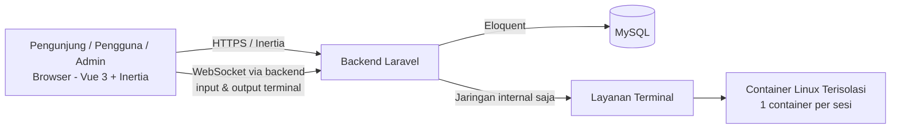

# SPEC.md — LinuxLab

> **Dokumen ini adalah sumber kebenaran (source of truth) untuk pembangunan LinuxLab.**
> Dokumen ini disusun mengikuti alur *Spec-Driven Development* (SDD): spesifikasi ditulis dan disepakati terlebih dahulu, kemudian implementasi dilakukan fase demi fase mengacu pada dokumen ini.
>
> - **Status:** Disetujui untuk implementasi (v1.1)
> - **Versi:** 1.1 — 19 Oktober 2026 (riwayat perubahan pada Bagian 18.3)
> - **Dokumen induk:** Laporan Proposal LinuxLab (Desain Aplikasi LinuxLab — Platform Belajar Linux Interaktif untuk Pemula Berbasis Web). Jika terjadi perbedaan antara dokumen ini dan laporan proposal, **dokumen ini yang berlaku untuk implementasi**, dan perbedaannya wajib dicatat pada Bagian 18.
> - **Cara pakai di Antigravity:** letakkan file ini di root proyek sebagai `SPEC.md`. Agen wajib membaca seluruh dokumen ini sebelum menulis kode, mengerjakan **satu fase pada satu waktu** (Bagian 15), dan tidak menandai fase selesai sebelum seluruh *acceptance criteria* fase tersebut terpenuhi dan terverifikasi.

---

## 0. Instruksi untuk Agen / Pengembang

1. **Jangan mengubah stack teknologi** pada Bagian 4 tanpa persetujuan tertulis dari pemilik proyek. Khususnya: database adalah **MySQL** (bukan PostgreSQL/SQLite untuk production), frontend adalah **Vue 3 + TypeScript** yang dihubungkan ke backend **Laravel** melalui **Inertia.js**.
2. Kerjakan implementasi mengikuti urutan fase pada Bagian 15. Jangan melompat ke fase berikutnya apabila fase berjalan belum memenuhi *Definition of Done* (Bagian 16).
3. Setiap kebutuhan diberi kode (mis. `FR-AUTH-01`, `SEC-TERM-01`). Kode ini digunakan dalam pesan commit, *pull request*, dan laporan pengujian agar setiap baris kode dapat ditelusur kembali ke spesifikasi.
4. Apabila ditemukan kebutuhan yang belum diatur dalam dokumen ini, gunakan **keputusan bawaan (default)** pada Bagian 18. Apabila tidak ada default, **berhenti dan tanyakan** — jangan mengarang perilaku baru, terutama yang menyangkut keamanan terminal.
5. Dilarang mengekspos Docker daemon (socket/API Docker) secara langsung ke browser atau jaringan publik dalam bentuk apa pun (`SEC-TERM-01`).
6. Seluruh teks antarmuka pengguna menggunakan **Bahasa Indonesia**. Istilah teknis Linux (nama perintah, path, permission) tetap dalam bentuk aslinya.

---

## 1. Ringkasan Produk

### 1.1 Deskripsi

LinuxLab adalah platform pembelajaran Linux interaktif berbasis web untuk pemula. Pengguna mempelajari materi Linux secara terstruktur, mencoba perintah langsung pada terminal interaktif yang berjalan di **container Linux yang terisolasi**, mengerjakan latihan yang dinilai secara otomatis, memantau perkembangan belajar, memperoleh lencana (badge) pencapaian, dan berdiskusi dengan pengguna lain melalui forum yang terhubung dengan pelajaran.

### 1.2 Masalah yang Diselesaikan

- Pemula Linux umumnya harus memasang Linux atau mesin virtual sendiri sebelum dapat berlatih, yang menjadi hambatan awal.
- Materi teks tanpa praktik langsung membuat pemahaman perintah Linux sulit bertahan.
- Latihan tanpa penilaian otomatis dan tanpa pelacakan progres membuat pengguna tidak tahu posisi dan kemajuannya.

### 1.3 Tujuan v1

1. Menyediakan alur belajar lengkap dalam satu aplikasi web: materi → praktik terminal → latihan ter-nilai → progres & lencana → diskusi.
2. Menyediakan terminal nyata (bukan simulasi teks) yang berjalan di lingkungan terisolasi dan aman untuk pemula.
3. Menyediakan panel administrator untuk mengelola seluruh konten pembelajaran tanpa mengubah kode.
4. Memotivasi penyelesaian seluruh modul melalui peringkat publik (leaderboard) dan sertifikat penyelesaian yang dapat diunduh serta diverifikasi.

### 1.4 Bukan Tujuan v1 (Non-Goals)

Lihat daftar lengkap *out of scope* pada Bagian 17. Ringkasnya: aplikasi mobile native, pembayaran/langganan, kelas dengan guru (cohort), dan multi-server/cluster **tidak** termasuk v1.

---

## 2. Istilah

| Istilah | Arti |
|---|---|
| Modul | Kelompok materi setingkat tema besar (mis. File System). Tabel: `modules`. |
| Pelajaran | Satu unit materi di dalam modul. Tabel: `lessons`. |
| Latihan | Tugas praktik ter-nilai yang melekat pada satu pelajaran. Tabel: `exercises`. |
| Hint | Petunjuk bertahap untuk satu latihan. Tabel: `hints`. |
| Sesi terminal | Satu container Linux terisolasi yang dibuat untuk satu pengguna pada satu sesi praktik. Tabel: `terminal_sessions`. |
| Percobaan | Satu kali pengiriman/penilaian jawaban latihan oleh pengguna. Tabel: `exercise_attempts`. |
| Lencana | Pencapaian yang diberikan otomatis bila kriteria terpenuhi. Tabel: `badges`, `user_badges`. |
| Leaderboard | Peringkat publik seluruh pengguna terdaftar berdasarkan total skor terbaik latihan (Bagian 6.H). |
| Sertifikat | Dokumen PDF bukti penyelesaian **seluruh** modul yang diterbitkan otomatis dan dapat diverifikasi dengan kode unik. Tabel: `certificates`. |
| Penilaian (validasi) | Pemeriksaan jawaban latihan berdasarkan `validation_type` dan `validation_config` pada `exercises`. |
| RBAC | *Role-Based Access Control* — pembatasan akses berdasarkan kolom `role` pada `users`. |

---

## 3. Aktor dan Hak Akses

Hanya ada **tiga aktor**. Proses otomatis (pembuatan container, penilaian, pembaruan progres, pemberian lencana) adalah **fungsi sistem**, bukan aktor terpisah.

| Kemampuan | Pengunjung | Pengguna Terdaftar | Administrator |
|---|:---:|:---:|:---:|
| Melihat halaman utama & informasi modul | ✓ | ✓ | ✓ |
| Registrasi akun | ✓ | — | — |
| Login / logout | — | ✓ | ✓ |
| Mengelola profil sendiri | — | ✓ | ✓ |
| Membaca materi & cheat sheet | — | ✓ | ✓ |
| Menggunakan terminal interaktif | — | ✓ | ✓ |
| Mengerjakan latihan & meminta hint | — | ✓ | ✓ |
| Melihat progres & lencana sendiri | — | ✓ | ✓ |
| Melihat leaderboard publik | ✓ | ✓ | ✓ |
| Mengunduh sertifikat sendiri (setelah menyelesaikan seluruh modul) | — | ✓ | — |
| Memverifikasi sertifikat dengan kode unik | ✓ | ✓ | ✓ |
| Bertanya / menjawab / upvote di forum | — | ✓ | ✓ |
| Menandai jawaban terbaik (untuk pertanyaannya sendiri) | — | ✓ | ✓ |
| Mengelola modul, pelajaran, latihan, hint, lencana | — | — | ✓ |
| Moderasi forum (menghapus pertanyaan/jawaban yang tidak pantas) | — | — | ✓ |
| Mengelola pengguna (melihat daftar, menonaktifkan akun) | — | — | ✓ |

Aturan penegakan:

- `RBAC-01` — Peran disimpan pada `users.role` dengan nilai `user` atau `admin`.
- `RBAC-02` — Pembatasan dilakukan di sisi server melalui *middleware* Laravel pada setiap route yang memerlukannya. Menyembunyikan menu di frontend **bukan** pengganti pembatasan server.
- `RBAC-03` — Pengunjung yang membuka halaman yang memerlukan login diarahkan ke halaman login.
- `RBAC-04` — Pengguna berperan `user` yang membuka route `/admin/*` menerima respons 403.

---

## 4. Stack Teknologi (Terkunci)

| Lapisan | Teknologi | Ketentuan |
|---|---|---|
| Backend | Laravel (PHP) | Versi LTS/stable terbaru saat proyek dibuat; pola MVC standar Laravel. |
| Frontend | Vue 3 + TypeScript | *Composition API*; seluruh komponen dan props bertipe. |
| Jembatan frontend–backend | Inertia.js | Tidak ada REST API terpisah untuk antarmuka web v1; data dikirim sebagai props Inertia. |
| Database | MySQL | Melalui Eloquent ORM dan *migration* Laravel. |
| Terminal di browser | xterm.js (atau pustaka emulator terminal setara) | Hanya berperan sebagai tampilan terminal di frontend; eksekusi selalu di container. |
| Lingkungan terminal | Container Linux terisolasi | Satu container per sesi terminal; dikelola **hanya** oleh backend/layanan terminal internal. |
| Transport terminal | WebSocket (melalui backend) | Browser tidak pernah berkomunikasi langsung dengan container maupun Docker daemon. |
| Autentikasi | Sesi Laravel | Bukan JWT. Password disimpan sebagai hash (mekanisme bawaan Laravel). |
| Pengujian | Pest atau PHPUnit (backend), Vitest (frontend, bila diperlukan) | Lihat Bagian 16. |
| Lingkungan awal | Satu server (pengembangan & pengujian) | Arsitektur tidak boleh mengasumsikan lebih dari satu server pada v1. |

### 4.1 Struktur Proyek yang Diharapkan

Struktur standar Laravel dengan Inertia + Vue, antara lain:

```
app/
  Http/Controllers/        # Controller per fitur (Auth, Module, Lesson, Exercise, Forum, Admin, ...)
  Http/Middleware/         # Middleware RBAC (role admin)
  Models/                  # Satu model Eloquent per tabel (Bagian 8)
  Services/
    TerminalService        # Satu-satunya komponen yang berbicara ke layanan terminal/container
    ValidationService      # Penilaian latihan (Bagian 11)
    ProgressService        # Pembaruan lesson_progress & module_progress
    BadgeService           # Evaluasi kriteria lencana (Bagian 12)
    CertificateService     # Penerbitan & verifikasi sertifikat (Bagian 6.I); peringkat leaderboard dihitung dari query agregasi tanpa service/tabel tersendiri
database/
  migrations/              # Satu migration per tabel, urutan mengikuti Bagian 8.3
  seeders/                 # Seeder konten awal (Bagian 7) & akun admin awal
resources/js/
  Pages/                   # Halaman Inertia (Bagian 10)
  Components/              # Komponen Vue yang dapat dipakai ulang (Terminal, ProgressBar, BadgeCard, ...)
  Layouts/                 # Layout publik, layout pengguna, layout admin
routes/web.php             # Seluruh route web (Bagian 9)
SPEC.md                    # Dokumen ini
```

### 4.2 Variabel Lingkungan (`.env`)

Nama variabel berikut wajib digunakan (nilai diisi di mesin masing-masing, **tidak pernah** di-commit):

```
APP_NAME=LinuxLab
DB_CONNECTION=mysql
DB_DATABASE=linuxlab
TERMINAL_IMAGE=            # image Linux dasar untuk container sesi
TERMINAL_CPU_LIMIT=        # batas CPU per container
TERMINAL_MEMORY_LIMIT=     # batas memori per container, mis. 256m
TERMINAL_SESSION_TTL=      # batas umur sesi dalam menit, mis. 30
TERMINAL_MAX_SESSIONS=     # batas jumlah sesi aktif bersamaan per server
CERTIFICATE_SIGNATORY_NAME=   # nama penanda tangan pada sertifikat (Bagian 18.2, Q-05)
CERTIFICATE_SIGNATORY_TITLE=  # jabatan penanda tangan pada sertifikat, mis. Dosen Pengampu
```

---

## 5. Arsitektur Sistem

### 5.1 Komponen

| Komponen | Tanggung jawab |
|---|---|
| Browser (Vue 3 + Inertia) | Menampilkan halaman, materi, forum, dan terminal (xterm.js); mengirim perintah pengguna ke backend. |
| Backend Laravel | Autentikasi & RBAC, logika bisnis, penilaian latihan, progres, lencana, forum, panel admin, dan satu-satunya penghubung ke layanan terminal dan database. |
| MySQL | Menyimpan seluruh data aplikasi (15 tabel, Bagian 8). |
| Layanan Terminal (internal) | Membuat, menjalankan, dan menghancurkan container Linux terisolasi atas permintaan backend; mengeksekusi perintah; memeriksa kondisi sistem untuk penilaian. Tidak dapat diakses dari browser/jaringan publik. |

### 5.2 Alur Utama



### 5.3 Alur Sesi Terminal

1. Pengguna menekan **Mulai Praktik** pada suatu pelajaran/latihan.
2. Backend memeriksa autentikasi, membuat container baru melalui layanan terminal, dan mencatat sesi pada `terminal_sessions` (`container_id`, `status=active`, `expires_at`).
3. Setiap perintah yang diketik pengguna diteruskan frontend → backend → container yang sama; output dikembalikan dengan alur sebaliknya.
4. Sesi berakhir apabila pengguna menutup praktik, sesi melewati `expires_at`, atau dibersihkan oleh tugas terjadwal. Container **selalu dihancurkan** pada akhir sesi.
5. Perubahan filesystem di dalam container **tidak persisten**: pada kunjungan berikutnya pengguna mendapat lingkungan baru. Ketentuan ini wajib ditampilkan sebagai keterangan di halaman praktik.


---

## 6. Kebutuhan Fungsional

Setiap kebutuhan memiliki *acceptance criteria* (AC). Format AC menggunakan pola: **Diberikan** (kondisi awal) → **Ketika** (aksi) → **Maka** (hasil yang diharapkan).

### 6.A Autentikasi dan Pengguna

**FR-AUTH-01 — Registrasi**
Pengunjung dapat membuat akun dengan `name`, `username`, `email`, dan `password`.

- AC: username dan email harus unik; pelanggaran mengembalikan pesan kesalahan pada field terkait (data tersimpan di `users` dengan `role=user`).
- AC: password tidak pernah disimpan sebagai teks biasa dan tidak pernah ditampilkan kembali.
- AC: setelah registrasi berhasil, pengguna diarahkan ke halaman login dengan pesan sukses.

**FR-AUTH-02 — Login dan Logout (sesi Laravel)**
- AC: login berhasil membuat sesi Laravel dan mengarahkan `user` ke dashboard pengguna serta `admin` ke dashboard admin.
- AC: kredensial salah mengembalikan pesan kesalahan yang tidak membocorkan apakah email atau password yang salah.
- AC: logout menghapus sesi dan mengarahkan ke halaman utama.

**FR-AUTH-03 — Profil**
Pengguna terdaftar dapat melihat dan mengubah `name` serta password-nya sendiri. Mengubah data pengguna lain tidak diperbolehkan (diperiksa di server).

### 6.B Modul Pembelajaran

**FR-MOD-01 — Daftar dan Detail Modul**
Pengguna terdaftar melihat daftar modul beserta persentase penyelesaiannya; membuka modul menampilkan daftar pelajarannya berurutan (`lessons.order`).

**FR-MOD-02 — Materi Pelajaran**
Setiap pelajaran menampilkan: judul, isi materi (`lessons.content`), contoh perintah (`lessons.example_commands`), dan cheat sheet (`lessons.cheat_sheet`). Tombol **Mulai Praktik** mengarah ke halaman praktik pelajaran/latihan terkait.

**FR-MOD-03 — Konten awal** wajib memenuhi Bagian 7 dokumen ini.

### 6.C Terminal Linux Interaktif

**FR-TERM-01 — Membuat Sesi**
Ketika pengguna memulai praktik, sistem membuat satu container terisolasi dan satu baris `terminal_sessions`. Satu pengguna hanya boleh memiliki **satu sesi aktif** pada satu waktu; memulai sesi baru mengakhiri sesi lama.

**FR-TERM-02 — Eksekusi Perintah Nyata**
Perintah dieksekusi oleh shell Linux di dalam container (bukan simulasi/pencocokan teks di frontend). Output (stdout/stderr) ditampilkan apa adanya pada terminal di browser.

**FR-TERM-03 — Isolasi dan Pembatasan** wajib memenuhi seluruh ketentuan keamanan pada Bagian 13.

**FR-TERM-04 — Akhir Sesi dan Pembersihan**
Sesi yang kedaluwarsa atau ditinggalkan dibersihkan otomatis: container dihancurkan dan `terminal_sessions.status` menjadi `expired`/`terminated` beserta `ended_at`.

**FR-TERM-05 — Keterangan Non-Persisten**
Halaman praktik menampilkan keterangan bahwa file yang dibuat di dalam sesi tidak tersimpan untuk kunjungan berikutnya.

### 6.D Latihan dan Penilaian Otomatis

**FR-EX-01 — Mengerjakan Latihan**
Setiap pelajaran dapat memiliki satu atau lebih latihan. Halaman praktik menampilkan instruksi latihan (`exercises.instruction`), terminal, tombol **Periksa Jawaban**, dan tombol **Minta Hint**.

**FR-EX-02 — Penilaian** mengikuti mesin penilaian pada Bagian 11.
- AC: setiap penekanan tombol Periksa Jawaban membuat **satu baris baru** pada `exercise_attempts` (termasuk percobaan yang gagal) berisi `is_correct`, `score`, dan `feedback`.
- AC: pengguna menerima umpan balik yang jelas apakah jawabannya benar atau belum beserta alasannya.
- AC: penilaian **tidak boleh** hanya mencocokkan teks output apabila jenis pemeriksaan kondisi sistem (`system_state`) lebih tepat untuk latihan tersebut — jenis pemeriksaan ditentukan oleh `validation_type` latihan.

**FR-EX-03 — Hint Bertahap**
Hint ditampilkan satu per satu sesuai `hints.order` setiap kali pengguna meminta. Hint yang sudah dibuka tetap terlihat. Sistem mencatat hint yang dibuka agar dapat ditampilkan kembali (jumlah hint yang dibuka boleh memengaruhi skor hanya apabila aturan itu ditulis pada `validation_config` latihan terkait — bawaan: **tidak mengurangi skor**).

**FR-EX-04 — Riwayat Percobaan**
Pengguna dapat melihat riwayat hasil latihannya (dari `exercise_attempts`) pada halaman progres.

### 6.E Pelacakan Kemajuan dan Lencana

**FR-PROG-01 — Progres Pelajaran**
Status setiap pelajaran per pengguna disimpan pada `lesson_progress` (`not_started` / `in_progress` / `completed`). Pelajaran dinyatakan `completed` apabila seluruh latihan wajib pada pelajaran tersebut telah dijawab benar sekurang-kurangnya satu kali.

**FR-PROG-02 — Progres Modul**
`module_progress.completion_percentage` diperbarui setiap kali ada perubahan `lesson_progress` pada modul tersebut (persentase pelajaran `completed` terhadap seluruh pelajaran dalam modul). Status modul menjadi `completed` pada 100%.

**FR-PROG-03 — Dashboard Progres**
Dashboard pengguna menampilkan: progres keseluruhan, kartu setiap modul beserta persentasenya, tombol **Lanjutkan Belajar** yang mengarah ke pelajaran terakhir yang belum selesai, dan daftar lencana terakhir yang diperoleh.

**FR-PROG-04 — Lencana Otomatis**
Setelah setiap penilaian yang benar dan setiap penyelesaian pelajaran/modul, sistem mengevaluasi kriteria lencana (Bagian 12) dan mencatat pemberian pada `user_badges`. Satu lencana hanya dapat diberikan satu kali kepada pengguna yang sama (`UNIQUE(user_id, badge_id)`).

**FR-PROG-05 — Halaman Pencapaian**
Menampilkan lencana yang sudah diperoleh (beserta tanggal perolehan) dan lencana yang masih terkunci beserta kriterianya.

### 6.F Forum Diskusi

**FR-FORUM-01 — Pertanyaan Terikat Pelajaran**
Pengguna terdaftar membuat pertanyaan (`questions`) dari halaman pelajaran tertentu; `lesson_id` terisi otomatis dari konteks pelajaran dan tidak dapat diubah oleh pengguna.

**FR-FORUM-02 — Jawaban**
Pengguna lain (dan penanya sendiri) dapat menulis jawaban (`answers`) pada suatu pertanyaan.

**FR-FORUM-03 — Upvote**
Setiap pengguna dapat memberikan maksimal **satu** upvote untuk setiap jawaban, ditegakkan oleh `UNIQUE(answer_id, user_id)` pada `answer_votes` dan pemeriksaan di server. Pengguna tidak dapat meng-upvote jawabannya sendiri. Jumlah upvote suatu jawaban adalah jumlah baris `answer_votes` untuk jawaban tersebut.

**FR-FORUM-04 — Jawaban Terbaik**
Hanya penanya yang dapat menandai satu jawaban pada pertanyaannya sebagai jawaban terbaik (`answers.is_best_answer`). Menandai jawaban lain menggantikan tanda sebelumnya. Pertanyaan yang telah memiliki jawaban terbaik ditandai terselesaikan (`questions.is_resolved = true`).

**FR-FORUM-05 — Urutan Tampilan**
Daftar pertanyaan pada satu pelajaran diurutkan dari yang terbaru. Jawaban ditampilkan dengan jawaban terbaik di posisi teratas, kemudian berdasarkan jumlah upvote terbanyak.

### 6.G Dashboard Administrator

**FR-ADMIN-01 — CRUD Konten**
Administrator mengelola (buat, lihat, ubah, hapus): modul, pelajaran, latihan beserta `validation_type` dan `validation_config`, serta hint untuk setiap latihan.

**FR-ADMIN-02 — Kelola Lencana**
Administrator mengelola master lencana pada `badges`, termasuk `criteria_type` dan `criteria_value`.

**FR-ADMIN-03 — Moderasi Forum**
Administrator dapat menghapus pertanyaan atau jawaban yang tidak pantas. Penghapusan jawaban juga menghapus `answer_votes` terkait (aturan *cascade* pada Bagian 8).

**FR-ADMIN-04 — Kelola Pengguna**
Administrator melihat daftar pengguna dan dapat menonaktifkan akun (akun nonaktif tidak dapat login). Administrator **tidak dapat** menonaktifkan atau mengubah peran akunnya sendiri melalui panel ini.

**FR-ADMIN-05 — Ringkasan Statistik**
Dashboard admin menampilkan ringkasan: jumlah pengguna terdaftar, jumlah modul/pelajaran/latihan, dan jumlah pertanyaan forum. Statistik bersifat tampilan dari data yang ada — tidak ada data statistik yang dibuat manual.

### 6.H Leaderboard Publik

**FR-LEAD-01 — Halaman Leaderboard Publik**
Semua orang — termasuk Pengunjung yang belum login — dapat membuka halaman leaderboard. Yang tampil pada peringkat hanyalah akun berperan `user` yang aktif dan telah menyelesaikan benar sekurang-kurangnya satu latihan. Akun `admin` tidak masuk peringkat.

**FR-LEAD-02 — Dasar Perhitungan Peringkat**
- Total skor seorang pengguna adalah **jumlah skor terbaik per latihan** dari `exercise_attempts` (percobaan berulang pada latihan yang sama tidak menggandakan skor; yang dihitung adalah skor tertinggi yang pernah dicapai untuk latihan tersebut).
- Urutan peringkat: (1) total skor tertinggi; (2) apabila sama, jumlah latihan yang diselesaikan benar terbanyak; (3) apabila masih sama, yang lebih dulu mencapai total skor tersebut (berdasarkan waktu percobaan benar pertamanya).
- Data pendamping yang ditampilkan: nama/username, total skor, jumlah latihan selesai, jumlah modul selesai (dari `module_progress`), dan jumlah lencana (dari `user_badges`).
- Leaderboard v1 bersifat **sepanjang waktu (all-time)**; tidak ada peringkat mingguan/bulanan dan tidak ada hadiah.
- Peringkat dihitung dari data yang ada pada `exercise_attempts`, `module_progress`, dan `user_badges` saat halaman dibuka — tidak ada tabel peringkat tersendiri dan tidak ada skor yang dimasukkan secara manual.

**FR-LEAD-03 — Posisi Pengguna Sendiri**
Pengguna yang sedang login dan masuk peringkat melihat barisnya disorot pada leaderboard. Dashboard pengguna menampilkan peringkatnya saat ini (atau keterangan bahwa ia belum masuk peringkat).

**FR-LEAD-04 — Data yang Ditampilkan ke Publik**
Leaderboard hanya menampilkan nama/username, skor, dan capaian belajar. Alamat email dan data pribadi lain **tidak pernah** ditampilkan pada leaderboard.

### 6.I Sertifikat Penyelesaian

**FR-CERT-01 — Syarat Penerbitan**
Sertifikat diterbitkan untuk seorang pengguna berperan `user` apabila **seluruh modul yang diterbitkan (`modules.is_published = true`) telah berstatus `completed`** pada `module_progress` pengguna tersebut. Dengan konten awal, artinya ketiga modul — File System, Permission, dan Text Processing — selesai 100%.

**FR-CERT-02 — Penerbitan Otomatis dan Satu Kali**
- Pada saat syarat FR-CERT-01 pertama kali terpenuhi (di dalam rangkaian pembaruan progres pada Bagian 11, `VAL-05`), sistem membuat tepat satu baris pada `certificates` untuk pengguna tersebut (`UNIQUE(user_id)`), berisi nama penerima saat penerbitan (`recipient_name`, diambil dari `users.name`), kode unik (`certificate_code`), dan tanggal penerbitan (`issued_at`).
- Format kode: `LLAB-<tahun penerbitan>-<6 karakter acak huruf besar & angka>`, unik pada tingkat database, dan tidak dapat ditebak dari `user_id`.
- Apabila administrator kemudian menerbitkan modul baru, sertifikat yang sudah terbit **tetap sah** dan tidak dicabut; syarat FR-CERT-01 berlaku pada saat penerbitan.

**FR-CERT-03 — Unduh Sertifikat (PDF)**
Pengguna yang telah memiliki sertifikat dapat mengunduhnya sebagai PDF dari halaman Pencapaian. Isi sertifikat: nama LinuxLab, judul "Sertifikat Penyelesaian", nama penerima, pernyataan bahwa penerima telah menyelesaikan seluruh modul pembelajaran LinuxLab beserta daftar nama modulnya, tanggal penerbitan, kode sertifikat, dan nama/jabatan penanda tangan sesuai konfigurasi `CERTIFICATE_SIGNATORY_NAME` / `CERTIFICATE_SIGNATORY_TITLE` (Bagian 18.2, Q-05). Sertifikat dibuat di sisi server (mis. dengan pustaka PDF Laravel seperti dompdf); pengguna hanya dapat mengunduh sertifikat miliknya sendiri.

**FR-CERT-04 — Verifikasi Publik**
Siapa pun dapat memverifikasi sertifikat melalui halaman publik dengan memasukkan/membuka kode sertifikat. Hasil verifikasi hanya menampilkan: nama penerima, tanggal penerbitan, daftar modul yang diselesaikan, dan status "Sah" atau "Tidak ditemukan" — tanpa data pribadi lain. Kode yang tidak terdaftar dinyatakan tidak sah secara jelas.

**FR-CERT-05 — Belum Memenuhi Syarat**
Pengguna yang belum menyelesaikan seluruh modul melihat pada halaman Pencapaian kartu sertifikat dalam keadaan terkunci beserta keterangan modul yang belum selesai — tanpa tombol unduh.

---

## 7. Konten Pembelajaran Awal (Seeder)

Konten berikut wajib tersedia melalui *seeder* pada instalasi awal. Setiap modul minimal berisi **3 pelajaran**, dan setiap pelajaran minimal berisi **2 latihan** yang dapat dinilai otomatis sesuai Bagian 11.

### Modul 1 — File System

| Pelajaran | Materi pokok | Contoh latihan |
|---|---|---|
| 1.1 Navigasi Direktori | `pwd`, `ls`, `cd`, path absolut & relatif | Menampilkan lokasi direktori saat ini; berpindah ke direktori yang ditentukan |
| 1.2 Membuat dan Mengelola File | `touch`, `mkdir`, `cp`, `mv`, `rm` | Membuat struktur direktori dan file sesuai instruksi |
| 1.3 Melihat Isi File | `cat`, `head`, `tail`, `less` | Menampilkan baris tertentu dari sebuah file |

### Modul 2 — Permission

| Pelajaran | Materi pokok | Contoh latihan |
|---|---|---|
| 2.1 Membaca Permission | Notasi `rwx`, pemilik/grup/other, `ls -l` | Mengidentifikasi permission sebuah file dari keluaran `ls -l` |
| 2.2 Mengubah Permission | `chmod` (simbolik dan oktal) | Mengubah permission file menjadi nilai yang ditentukan (dinilai dengan pemeriksaan kondisi sistem) |
| 2.3 Kepemilikan File | `chown`, `chgrp` (konsep dan batasannya dalam container) | Menjelaskan/mengatur kepemilikan sesuai instruksi yang aman dalam container |

### Modul 3 — Text Processing

| Pelajaran | Materi pokok | Contoh latihan |
|---|---|---|
| 3.1 Mencari Teks | `grep` dan opsi dasarnya | Menemukan baris yang memuat kata tertentu dalam file |
| 3.2 Redirection dan Pipe | `>`, `>>`, `\|`, `wc`, `sort` | Mengarahkan keluaran perintah ke file; menghitung jumlah baris/kata |
| 3.3 Memotong dan Menyaring Teks | `cut`, `head`/`tail` lanjutan, kombinasi pipe | Menghasilkan keluaran teks sesuai format yang diminta |

Setiap pelajaran wajib dilengkapi `example_commands` dan `cheat_sheet` yang relevan dengan materi pokoknya.

---

## 8. Rancangan Data (MySQL)

Basis data MySQL terdiri atas **15 tabel** berikut: 14 tabel sesuai rancangan pada laporan proposal, ditambah tabel `certificates` untuk fitur sertifikat v1 (perubahan tercatat pada Bagian 18.3). Nama tabel, kolom kunci, dan relasi pada bagian ini bersifat mengikat; 14 tabel pertama harus sama dengan yang digunakan pada diagram RAT/ERD laporan proposal.

### 8.1 Daftar Tabel

| # | Tabel | Fungsi | Kolom kunci |
|---|---|---|---|
| 1 | `users` | Akun pengguna terdaftar dan administrator (RBAC lewat `role`) | `id` PK; `username` UQ; `email` UQ |
| 2 | `modules` | Master modul belajar | `id` PK; `slug` UQ |
| 3 | `lessons` | Materi dan cheat sheet per pelajaran | `id` PK; `module_id` FK → `modules.id`; `slug` UQ |
| 4 | `exercises` | Latihan dan aturan penilaiannya | `id` PK; `lesson_id` FK → `lessons.id` |
| 5 | `hints` | Petunjuk bertahap per latihan | `id` PK; `exercise_id` FK → `exercises.id` |
| 6 | `terminal_sessions` | Sesi container per pengguna | `id` PK; `user_id` FK; `exercise_id` FK (nullable); `container_id` |
| 7 | `exercise_attempts` | Satu baris untuk setiap percobaan penilaian | `id` PK; `user_id` FK; `exercise_id` FK; `terminal_session_id` FK (nullable) |
| 8 | `lesson_progress` | Status penyelesaian per pelajaran per pengguna | `id` PK; `user_id` FK; `lesson_id` FK; UQ (`user_id`, `lesson_id`) |
| 9 | `module_progress` | Agregat penyelesaian per modul per pengguna | `id` PK; `user_id` FK; `module_id` FK; UQ (`user_id`, `module_id`) |
| 10 | `badges` | Master lencana dan kriterianya | `id` PK |
| 11 | `user_badges` | Lencana yang telah diperoleh pengguna | `id` PK; `user_id` FK; `badge_id` FK; UQ (`user_id`, `badge_id`) |
| 12 | `questions` | Pertanyaan forum yang terikat pada satu pelajaran | `id` PK; `user_id` FK; `lesson_id` FK |
| 13 | `answers` | Jawaban atas suatu pertanyaan | `id` PK; `question_id` FK → `questions.id`; `user_id` FK |
| 14 | `answer_votes` | Upvote jawaban (satu per pengguna per jawaban) | `id` PK; `answer_id` FK → `answers.id`; `user_id` FK; UQ (`answer_id`, `user_id`) |
| 15 | `certificates` | Sertifikat penyelesaian seluruh modul yang diterbitkan untuk seorang pengguna | `id` PK; `user_id` FK → `users.id` (UQ — satu sertifikat per pengguna); `certificate_code` UQ |

Seluruh tabel memiliki `created_at` dan `updated_at`, kecuali tabel peristiwa (`exercise_attempts`, `user_badges`, `answer_votes`) yang cukup memiliki kolom waktu kejadiannya sendiri (`created_at` / `awarded_at`). Tabel `certificates` memiliki `issued_at` sebagai waktu penerbitan di samping `created_at`.

### 8.2 Kolom Penting per Tabel

- **users**: `name`, `username`, `email`, `password` (hash), `role` ENUM(`user`, `admin`) default `user`, `is_active` (untuk FR-ADMIN-04).
- **modules**: `title`, `slug`, `description`, `order`, `is_published`.
- **lessons**: `module_id`, `title`, `slug`, `content` (teks panjang), `example_commands` (teks), `cheat_sheet` (teks), `order`.
- **exercises**: `lesson_id`, `title`, `instruction` (teks), `validation_type` ENUM(`system_state`, `output`, `combined`), `validation_config` (JSON), `points` (skor maksimum), `order`.
- **hints**: `exercise_id`, `content`, `order`.
- **terminal_sessions**: `user_id`, `exercise_id` (nullable — sesi praktik bebas), `container_id`, `status` ENUM(`active`, `expired`, `terminated`), `expires_at`, `ended_at` (nullable).
- **exercise_attempts**: `user_id`, `exercise_id`, `terminal_session_id` (nullable), `is_correct` (boolean), `score`, `feedback` (teks hasil pemeriksaan).
- **lesson_progress**: `user_id`, `lesson_id`, `status` ENUM(`not_started`, `in_progress`, `completed`), `completed_at` (nullable).
- **module_progress**: `user_id`, `module_id`, `completion_percentage` (0–100), `status` ENUM(`not_started`, `in_progress`, `completed`).
- **badges**: `name`, `description`, `icon`, `criteria_type`, `criteria_value`.
- **user_badges**: `user_id`, `badge_id`, `awarded_at`.
- **questions**: `user_id`, `lesson_id`, `title`, `body`, `is_resolved` (boolean).
- **answers**: `question_id`, `user_id`, `body`, `is_best_answer` (boolean).
- **answer_votes**: `answer_id`, `user_id`.
- **certificates**: `user_id`, `recipient_name` (nama penerima saat penerbitan), `certificate_code`, `issued_at`.

### 8.3 Relasi dan Aturan Integritas

- Seluruh relasi berbentuk **satu ke banyak (1:N)**: `users` 1:N ke `terminal_sessions`, `exercise_attempts`, `lesson_progress`, `module_progress`, `user_badges`, `questions`, `answers`, `answer_votes`; `modules` 1:N `lessons` dan `module_progress`; `lessons` 1:N `exercises`, `questions`, `lesson_progress`; `exercises` 1:N `hints`, `exercise_attempts`, `terminal_sessions`; `badges` 1:N `user_badges`; `questions` 1:N `answers`; `answers` 1:N `answer_votes`. Relasi `users` ke `certificates` berbentuk **satu ke satu (1:1)** melalui `certificates.user_id` yang unik.
- Leaderboard (Bagian 6.H) **tidak** memiliki tabel sendiri; peringkat dihitung dari `exercise_attempts`, `module_progress`, dan `user_badges`.
- Relasi banyak ke banyak diwujudkan melalui tabel penghubung: `user_badges`, `answer_votes`, `lesson_progress`, `module_progress`.
- Penghapusan data induk mengikuti aturan: menghapus modul menghapus pelajaran, latihan, dan hint di bawahnya (*cascade*); menghapus pertanyaan menghapus jawaban dan vote-nya; menghapus pengguna **tidak** menghapus konten forum yang sudah dibuat — penulis ditampilkan sebagai "Pengguna nonaktif" (konten pembelajaran dan diskusi adalah data bersama).
- Urutan migration mengikuti urutan nomor tabel pada Bagian 8.1 agar seluruh foreign key dapat dibuat tanpa penundaan.


---

## 9. Route dan Halaman (Inertia)

Seluruh halaman dirender melalui Inertia. Nama route mengikuti konvensi Laravel (`route name` di kolom terakhir bersifat acuan implementasi).

### 9.1 Publik (Pengunjung)

| Method & Path | Halaman | Keterangan |
|---|---|---|
| `GET /` | Halaman Utama | Pengenalan LinuxLab, daftar modul yang tersedia (judul & deskripsi), ajakan registrasi. `home` |
| `GET /leaderboard` | Leaderboard Publik | FR-LEAD-01 s.d. 04; dapat dibuka tanpa login. `leaderboard` |
| `GET /certificates/verify/{code}` | Verifikasi Sertifikat | FR-CERT-04; dapat dibuka tanpa login. `certificates.verify` |
| `GET /register` | Registrasi | Formulir FR-AUTH-01. `register` |
| `POST /register` | — | Memproses registrasi. |
| `GET /login` | Login | Formulir FR-AUTH-02. `login` |
| `POST /login` | — | Memproses login (sesi Laravel). |
| `POST /logout` | — | Mengakhiri sesi. `logout` |

### 9.2 Pengguna Terdaftar (middleware: auth)

| Method & Path | Halaman | Keterangan |
|---|---|---|
| `GET /dashboard` | Dashboard Pengguna | FR-PROG-03. `dashboard` |
| `GET /modules` | Daftar Modul | FR-MOD-01, beserta progres per modul. `modules.index` |
| `GET /modules/{module}/lessons/{lesson}` | Halaman Materi | FR-MOD-02. `lessons.show` |
| `GET /lessons/{lesson}/practice` | Halaman Praktik | Terminal + latihan + hint (FR-TERM, FR-EX). `lessons.practice` |
| `POST /terminal/sessions` | — (API internal web) | Membuat sesi terminal (FR-TERM-01). |
| `DELETE /terminal/sessions/{session}` | — | Mengakhiri sesi. |
| Kanal WebSocket terminal | — | Input/output terminal melalui backend (Bagian 5.3). |
| `POST /exercises/{exercise}/check` | — | Menilai jawaban (Bagian 11), membuat `exercise_attempts`. `exercises.check` |
| `POST /exercises/{exercise}/hints` | — | Meminta hint berikutnya (FR-EX-03). |
| `GET /progress` | Progres & Riwayat | FR-PROG-02, FR-EX-04. `progress.index` |
| `GET /achievements` | Pencapaian | FR-PROG-05 dan kartu sertifikat (FR-CERT-03, FR-CERT-05). `achievements.index` |
| `GET /certificates/download` | — (unduh PDF) | Mengunduh sertifikat milik pengguna yang login (FR-CERT-03); 403 apabila belum memiliki sertifikat. `certificates.download` |
| `GET /lessons/{lesson}/forum` | Forum per Pelajaran | Daftar pertanyaan (FR-FORUM-01). `forum.index` |
| `POST /lessons/{lesson}/forum` | — | Membuat pertanyaan. `forum.store` |
| `GET /forum/{question}` | Detail Pertanyaan | Jawaban, upvote, jawaban terbaik. `forum.show` |
| `POST /forum/{question}/answers` | — | Menulis jawaban. `forum.answers.store` |
| `POST /answers/{answer}/vote` | — | Upvote (FR-FORUM-03). `answers.vote` |
| `POST /answers/{answer}/best` | — | Menandai jawaban terbaik (FR-FORUM-04, hanya penanya). `answers.best` |
| `GET /profile` / `PATCH /profile` | Profil | FR-AUTH-03. `profile` |

### 9.3 Administrator (middleware: auth + role admin, awalan `/admin`)

| Method & Path | Halaman | Keterangan |
|---|---|---|
| `GET /admin` | Dashboard Admin | Ringkasan statistik FR-ADMIN-05. `admin.dashboard` |
| `GET/POST/PATCH/DELETE /admin/modules…` | Kelola Modul | CRUD FR-ADMIN-01. |
| `GET/POST/PATCH/DELETE /admin/lessons…` | Kelola Pelajaran | CRUD termasuk `content`, `example_commands`, `cheat_sheet`. |
| `GET/POST/PATCH/DELETE /admin/exercises…` | Kelola Latihan | CRUD termasuk editor `validation_type` + `validation_config` (JSON, divalidasi formatnya sebelum disimpan). |
| `GET/POST/PATCH/DELETE /admin/exercises/{exercise}/hints…` | Kelola Hint | CRUD hint per latihan. |
| `GET/POST/PATCH/DELETE /admin/badges…` | Kelola Lencana | CRUD FR-ADMIN-02. |
| `GET /admin/forum`, `DELETE …` | Moderasi Forum | FR-ADMIN-03. |
| `GET /admin/users`, `PATCH /admin/users/{user}` | Kelola Pengguna | FR-ADMIN-04 (nonaktifkan/aktifkan). |

---

## 10. Rancangan Antarmuka (Halaman Wajib)

Sembilan rancangan berikut memperluas Bab Rancangan UI/UX laporan proposal (delapan rancangan pertama sesuai laporan; rancangan ke-9, Leaderboard & Verifikasi Sertifikat, adalah tambahan v1 pada SPEC versi 1.1). Seluruh halaman memakai kerangka yang sama (header "LinuxLab", navigasi, area konten) agar konsisten.

| # | Halaman | Komponen wajib | Sumber data utama |
|---|---|---|---|
| 1 | Halaman Utama | Judul & penjelasan singkat, kartu 3 modul awal, tombol Daftar / Masuk | `modules` |
| 2 | Login & Registrasi | Formulir email/username + password, tautan timbal-balik antar kedua halaman | `users` |
| 3 | Dashboard Pengguna & Daftar Modul | Progres keseluruhan, kartu modul + bar progres, tombol Lanjutkan Belajar, lencana terakhir, peringkat saat ini di leaderboard | `module_progress`, `user_badges`, `lesson_progress`, agregasi leaderboard |
| 4 | Halaman Materi & Cheat Sheet | Isi materi, blok contoh perintah, cheat sheet, daftar latihan, tombol Mulai Praktik, tautan forum pelajaran ini | `lessons`, `exercises` |
| 5 | Halaman Praktik (Terminal) | Panel kiri: instruksi latihan, daftar hint yang telah dibuka, tombol Periksa Jawaban & Minta Hint. Panel kanan: terminal + status sesi + sisa waktu sesi + keterangan non-persisten | `exercises`, `hints`, `terminal_sessions` |
| 6 | Progres & Pencapaian | Bar progres per modul, riwayat latihan, kisi lencana (diperoleh & terkunci beserta kriteria), kartu sertifikat (tombol unduh PDF apabila sudah terbit; keadaan terkunci beserta modul yang belum selesai apabila belum) | `module_progress`, `exercise_attempts`, `badges`, `user_badges`, `certificates` |
| 7 | Forum Diskusi | Daftar pertanyaan per pelajaran + status terselesaikan, formulir pertanyaan baru, halaman detail berisi jawaban terurut, tombol upvote, tanda jawaban terbaik | `questions`, `answers`, `answer_votes` |
| 8 | Dashboard Administrator | Menu samping (Modul, Pelajaran, Latihan & Hint, Lencana, Moderasi Forum, Pengguna), ringkasan statistik, tabel data dengan aksi ubah/hapus | Seluruh tabel terkait |
| 9 | Leaderboard & Verifikasi Sertifikat | Tabel peringkat (peringkat, nama/username, total skor, latihan selesai, modul selesai, jumlah lencana) dengan baris pengguna yang login disorot; formulir/halaman hasil verifikasi sertifikat berdasarkan kode | Agregasi `exercise_attempts`, `module_progress`, `user_badges`; `certificates` untuk verifikasi |

Ketentuan UI:

- `UI-01` — Halaman praktik harus tetap dapat digunakan pada lebar layar laptop standar; panel terminal tidak boleh tertutup panel instruksi.
- `UI-02` — Keadaan kosong (*empty state*) wajib dirancang untuk: pengguna baru tanpa progres, pelajaran tanpa latihan, forum tanpa pertanyaan, dan lencana yang belum ada yang diperoleh.
- `UI-03` — Umpan balik penilaian (benar/belum benar) ditampilkan jelas pada halaman praktik tanpa memuat ulang seluruh halaman.
- `UI-04` — Seluruh rancangan di atas adalah **wireframe/rancangan** sampai fase implementasinya pada Bagian 15 selesai; jangan menyebutnya fitur jadi sebelum terverifikasi.

---

## 11. Mesin Penilaian Latihan

### 11.1 Jenis Penilaian (`validation_type`)

| Nilai | Arti | Kapan dipakai |
|---|---|---|
| `system_state` | Memeriksa **kondisi sistem** di dalam container setelah pengguna bekerja (keberadaan/isi/permission file, dsb.) | Latihan yang hasil akhirnya berupa keadaan filesystem, mis. membuat struktur direktori atau mengubah permission. |
| `output` | Memeriksa **keluaran perintah** yang ditentukan pada `validation_config` (perintah pemeriksa dijalankan oleh backend di container, bukan menilai teks yang diketik pengguna) | Latihan yang hasil akhirnya berupa keluaran teks tertentu, mis. hasil `grep` atau `wc`. |
| `combined` | Gabungan keduanya; jawaban benar hanya apabila **seluruh** pemeriksaan lulus | Latihan yang menuntut keadaan sistem dan keluaran sekaligus benar. |

### 11.2 Format `validation_config` (JSON)

`validation_config` adalah objek JSON dengan daftar `checks`. Setiap check memiliki `type` dan parameternya. Jenis check awal yang wajib didukung:

```json
{
  "checks": [
    { "type": "file_exists",    "path": "/home/student/latihan/hello.txt" },
    { "type": "file_contains",  "path": "/home/student/latihan/hello.txt", "text": "Halo Linux" },
    { "type": "file_permission","path": "/home/student/latihan/run.sh", "mode": "755" },
    { "type": "directory_exists", "path": "/home/student/latihan/data" },
    { "type": "command_output_contains", "command": "ls /home/student/latihan", "text": "hello.txt" },
    { "type": "command_output_equals",   "command": "grep -c 'linux' /home/student/kata.txt", "text": "3" }
  ]
}
```

Aturan:

- `VAL-01` — Pemeriksaan dijalankan oleh `ValidationService` melalui layanan terminal terhadap container sesi aktif milik pengguna yang dinilai. Sesi orang lain tidak boleh dapat dinilai/diperiksa.
- `VAL-02` — Perintah pemeriksa pada check `command_output_*` **ditetapkan oleh administrator** pada `validation_config`, bukan berasal dari input pengguna.
- `VAL-03` — Skor: `score = points` apabila seluruh check yang disyaratkan lulus; `0` apabila tidak. Skor sebagian (parsial per check) hanya diterapkan apabila `validation_config` memuat `"partial": true`.
- `VAL-04` — `feedback` pada `exercise_attempts` berisi ringkasan check yang lulus dan yang gagal dalam Bahasa Indonesia yang dapat dipahami pemula (tanpa membocorkan jawaban penuh).
- `VAL-05` — Hasil penilaian selalu dicatat, memperbarui progres (Bagian 6.E), dan memicu evaluasi lencana — ketiga langkah ini adalah satu rangkaian yang tidak boleh terlewat apabila penilaian berhasil disimpan. Rangkaian yang sama juga memicu pemeriksaan syarat sertifikat (FR-CERT-01) setiap kali sebuah modul mencapai status `completed`.
- `VAL-06` — Apabila tidak ada sesi terminal aktif saat Periksa Jawaban ditekan, sistem membuat sesi baru terlebih dahulu **atau** menolak dengan pesan yang jelas bahwa praktik harus dimulai; perilaku bawaan yang dipilih: **menolak dengan pesan** agar keadaan container yang dinilai selalu berasal dari sesi yang sedang berjalan.

### 11.3 Contoh Pemetaan Latihan → Penilaian

| Latihan | `validation_type` | Check utama |
|---|---|---|
| Membuat file `hello.txt` berisi "Halo Linux" | `system_state` | `file_exists` + `file_contains` |
| Mengubah permission `run.sh` menjadi 755 | `system_state` | `file_permission` |
| Menghitung jumlah baris yang memuat kata "linux" | `output` | `command_output_equals` pada perintah `grep -c` |
| Membuat direktori `data` dan file hasil redirection di dalamnya | `combined` | `directory_exists` + `file_exists` |

---

## 12. Kriteria Lencana

Kriteria dibaca dari `badges.criteria_type` dan `badges.criteria_value` (JSON atau nilai sederhana sesuai jenisnya). Jenis kriteria awal yang wajib didukung oleh `BadgeService`:

| `criteria_type` | `criteria_value` | Arti |
|---|---|---|
| `first_exercise` | — | Menyelesaikan latihan pertama dengan benar. |
| `lesson_completed` | `{ "lesson_id": <id> }` | Menyelesaikan satu pelajaran tertentu. |
| `module_completed` | `{ "module_id": <id> }` | Menyelesaikan satu modul tertentu (progres modul 100%). |
| `exercises_count` | `{ "count": <n> }` | Telah menyelesaikan benar sekurang-kurangnya *n* latihan berbeda. |
| `first_question` | — | Membuat pertanyaan pertama di forum. |
| `best_answer` | `{ "count": <n> }` | Jawabannya ditandai sebagai jawaban terbaik sekurang-kurangnya *n* kali. |

Lencana awal yang wajib tersedia melalui seeder: **Langkah Pertama** (`first_exercise`), **Penjelajah File System** (`module_completed` → Modul File System), **Penjaga Izin** (`module_completed` → Modul Permission), **Ahli Teks** (`module_completed` → Modul Text Processing), **Pembelajar Tekun** (`exercises_count` = 10), **Suka Bertanya** (`first_question`), dan **Penolong Komunitas** (`best_answer` = 1).

---

## 13. Keamanan Terminal dan Sesi

Bagian ini bersifat **mengikat**. Penyimpangan dari bagian ini adalah cacat keamanan, bukan perbedaan gaya implementasi.

- `SEC-TERM-01` — Docker daemon (socket maupun API) **tidak pernah** diekspos ke browser, frontend, atau jaringan publik. Hanya `TerminalService` di backend yang berkomunikasi dengan layanan terminal melalui jaringan internal.
- `SEC-TERM-02` — Setiap sesi berjalan pada container yang **terisolasi**: satu container untuk satu pengguna/sesi; tidak ada container yang dipakai bergantian oleh dua pengguna.
- `SEC-TERM-03` — Setiap container dibatasi sumber dayanya: CPU dan memori dibatasi sesuai `TERMINAL_CPU_LIMIT` dan `TERMINAL_MEMORY_LIMIT`; jumlah proses dibatasi; container berjalan sebagai pengguna non-root di dalam container.
- `SEC-TERM-04` — Container **tidak memiliki akses jaringan keluar** (internet) kecuali apabila suatu latihan secara eksplisit memerlukannya dan diatur administrator; bawaan v1: tanpa jaringan keluar.
- `SEC-TERM-05` — Setiap sesi memiliki batas waktu (`TERMINAL_SESSION_TTL`, bawaan 30 menit). Sesi berakhir otomatis saat batas tercapai, dan halaman praktik menampilkan sisa waktu.
- `SEC-TERM-06` — Container dihancurkan dan seluruh perubahan filesystem di dalamnya dibuang pada akhir sesi (keterangan non-persisten pada FR-TERM-05).
- `SEC-TERM-07` — Perintah pengguna dieksekusi **di dalam** container sesi miliknya sendiri. Backend tidak pernah menjalankan perintah pengguna pada host/server utama, dan tidak pernah membangun perintah shell di host dari gabungan string input pengguna.
- `SEC-TERM-08` — Jumlah sesi aktif bersamaan dibatasi (`TERMINAL_MAX_SESSIONS`) agar satu server pengembangan tidak kehabisan sumber daya; permintaan melebihi batas menerima pesan "server praktik sedang penuh, coba lagi sesaat lagi".
- `SEC-TERM-09` — Kepemilikan sesi diperiksa pada setiap permintaan terminal dan penilaian: pengguna hanya dapat mengakses `terminal_sessions` miliknya (`user_id` sesuai sesi login).
- `SEC-GEN-01` — Seluruh formulir menggunakan perlindungan bawaan Laravel (CSRF, validasi input di server, hash password). Keluaran yang berasal dari pengguna (pertanyaan, jawaban, nama) di-escape pada tampilan untuk mencegah XSS.
- `SEC-GEN-02` — Dokumen ini **tidak** menyatakan sistem telah aman atau telah lulus pengujian keamanan; pernyataan semacam itu hanya boleh dibuat setelah pengujian nyata dilakukan dan didokumentasikan.

---

## 14. Kebutuhan Non-Fungsional

| Kode | Kebutuhan |
|---|---|
| `NFR-01` | Halaman web (di luar eksekusi perintah terminal) termuat wajar pada koneksi dan perangkat laptop standar yang dipakai untuk pengembangan/pengujian. |
| `NFR-02` | Output perintah terminal mulai tampil tanpa menunggu seluruh perintah selesai (streaming melalui WebSocket) untuk perintah yang berjalan lebih dari ±1 detik. |
| `NFR-03` | Seluruh data aplikasi hanya tersimpan di MySQL; tidak ada data progres/latihan yang hanya tersimpan di browser (local storage tidak menjadi sumber kebenaran). |
| `NFR-04` | Kode mengikuti konvensi Laravel dan Vue 3 + TypeScript; nama tabel, kolom, route, dan halaman mengikuti dokumen ini persis. |
| `NFR-05` | Aplikasi dapat dipasang dari awal pada satu server dengan langkah yang didokumentasikan di `README.md` proyek (instalasi dependensi, `cp .env.example .env`, migration, seeder, menjalankan server dan layanan terminal). |
| `NFR-06` | Pesan kesalahan yang ditampilkan ke pengguna menggunakan Bahasa Indonesia dan tidak menampilkan detail teknis internal (stack trace, query SQL, kredensial). |
| `NFR-07` | Bahasa Indonesia digunakan konsisten pada antarmuka dan laporan; istilah nama tabel/kolom tetap snake_case Inggris. |


---

## 15. Rencana Implementasi Bertahap (untuk Agen Antigravity)

Kerjakan fase secara berurutan. Setiap fase diakhiri dengan **verifikasi** sebelum lanjut. Format laporan penyelesaian fase: daftar kode kebutuhan yang selesai, cara memverifikasinya, dan hasilnya.

### Fase 0 — Inisialisasi Proyek
- Buat proyek Laravel + Inertia.js + Vue 3 + TypeScript; hubungkan ke MySQL; siapkan `.env` sesuai Bagian 4.2; letakkan `SPEC.md` ini di root.
- **Selesai bila:** aplikasi bawaan dapat dijalankan, halaman awal Inertia tampil, koneksi MySQL berhasil (`php artisan migrate:status` berjalan tanpa error).

### Fase 1 — Autentikasi dan RBAC
- Migration & model `users` (termasuk `role`, `is_active`); registrasi, login, logout berbasis sesi; profil; middleware role admin; layout publik & pengguna.
- **Mencakup:** FR-AUTH-01 s.d. 03, RBAC-01 s.d. 04.
- **Selesai bila:** seluruh AC pada FR-AUTH terpenuhi; route `/admin/*` menolak peran `user` dengan 403.

### Fase 2 — Konten Pembelajaran
- Migration & model `modules`, `lessons`; halaman daftar modul, detail modul, halaman materi & cheat sheet; seeder konten Bagian 7 (struktur modul & pelajaran; latihan boleh dilengkapi pada Fase 4).
- **Mencakup:** FR-MOD-01, FR-MOD-02, FR-MOD-03 (bagian materi).
- **Selesai bila:** pengguna terdaftar dapat membuka ketiga modul dan membaca seluruh materi beserta cheat sheet.

### Fase 3 — Terminal Interaktif
- Layanan terminal internal + `TerminalService`; migration `terminal_sessions`; pembuatan/penghancuran container; WebSocket melalui backend; komponen terminal (xterm.js) pada halaman praktik; pembatasan sesuai Bagian 13; pembersihan sesi kedaluwarsa (tugas terjadwal).
- **Mencakup:** FR-TERM-01 s.d. 05, SEC-TERM-01 s.d. 09.
- **Selesai bila:** pengguna dapat menjalankan perintah Linux nyata (mis. `pwd`, `ls`, membuat file) di container miliknya; sesi pengguna lain tidak dapat diakses; container hancur setelah sesi berakhir/kedaluwarsa; filesystem tidak persisten pada sesi berikutnya.

### Fase 4 — Latihan, Hint, dan Penilaian
- Migration & model `exercises`, `hints`, `exercise_attempts`; `ValidationService` sesuai Bagian 11 termasuk jenis check awal; halaman praktik lengkap (instruksi, hint bertahap, Periksa Jawaban, feedback).
- **Mencakup:** FR-EX-01 s.d. 04, VAL-01 s.d. 06; seeder latihan & hint Bagian 7 dilengkapi.
- **Selesai bila:** contoh pemetaan pada Bagian 11.3 seluruhnya menilai dengan benar (jawaban benar → lulus; jawaban salah → gagal dengan feedback), dan setiap percobaan tercatat pada `exercise_attempts`.

### Fase 5 — Progres, Lencana, Leaderboard, dan Sertifikat
- Migration & model `lesson_progress`, `module_progress`, `badges`, `user_badges`, `certificates`; `ProgressService`, `BadgeService` (Bagian 12), dan `CertificateService` (Bagian 6.I); dashboard pengguna, halaman progres & riwayat, halaman pencapaian (termasuk kartu sertifikat); halaman leaderboard publik dan halaman verifikasi sertifikat; seeder lencana awal.
- **Mencakup:** FR-PROG-01 s.d. 05, FR-LEAD-01 s.d. 04, FR-CERT-01 s.d. 05.
- **Selesai bila:** menyelesaikan latihan memperbarui progres pelajaran & modul dengan persentase yang benar; lencana awal diberikan tepat satu kali pada saat kriterianya terpenuhi; tombol Lanjutkan Belajar mengarah ke pelajaran yang benar; leaderboard menampilkan peringkat sesuai perhitungan FR-LEAD-02 (skor terbaik per latihan, tanpa email, tanpa akun admin); menyelesaikan seluruh modul yang diterbitkan menerbitkan tepat satu sertifikat yang dapat diunduh sebagai PDF dan terverifikasi "Sah" melalui kode uniknya, sedangkan kode acak dinyatakan tidak ditemukan.

### Fase 6 — Forum Diskusi
- Migration & model `questions`, `answers`, `answer_votes`; forum per pelajaran, detail pertanyaan, upvote, jawaban terbaik.
- **Mencakup:** FR-FORUM-01 s.d. 05.
- **Selesai bila:** pertanyaan terikat pada pelajaran; upvote ganda tertolak (termasuk pada tingkat database); hanya penanya yang dapat menandai jawaban terbaik; urutan tampilan sesuai FR-FORUM-05.

### Fase 7 — Dashboard Administrator
- CRUD modul, pelajaran, latihan (termasuk editor `validation_config` dengan validasi JSON), hint, lencana; moderasi forum; kelola pengguna; ringkasan statistik.
- **Mencakup:** FR-ADMIN-01 s.d. 05.
- **Selesai bila:** admin dapat membuat satu modul + pelajaran + latihan + hint dari panel dan konten tersebut langsung dapat dipakai pengguna; admin tidak dapat menonaktifkan akunnya sendiri.

### Fase 8 — Pengerasan dan Penyelesaian
- Periksa kembali seluruh ketentuan Bagian 13 & 14; keadaan kosong (UI-02); pesan kesalahan Bahasa Indonesia (NFR-06); `README.md` berisi langkah pemasangan lengkap (NFR-05); pengujian akhir Bagian 16.
- **Selesai bila:** seluruh *Definition of Done* pada Bagian 16 terpenuhi.

---

## 16. Pengujian dan Definition of Done

### 16.1 Pengujian Minimum per Fase

- Setiap FR memiliki minimal satu pengujian otomatis (Pest/PHPUnit untuk logika backend: penilaian, progres, lencana, perhitungan leaderboard, penerbitan & verifikasi sertifikat, upvote, RBAC) **atau** skenario uji manual terdokumentasi dengan hasil yang dicatat.
- Penilaian latihan (Bagian 11) wajib memiliki pengujian otomatis untuk sekurang-kurangnya: satu latihan `system_state`, satu `output`, satu `combined`, masing-masing untuk jawaban benar dan jawaban salah.
- Keamanan terminal diverifikasi secara manual terdokumentasi: mencoba mengakses sesi pengguna lain (harus tertolak), memeriksa batas waktu sesi, dan memastikan container tidak lagi ada setelah sesi berakhir.

### 16.2 Definition of Done (Keseluruhan v1)

- [ ] Seluruh fase 0–8 selesai dan terverifikasi sesuai kriterianya masing-masing.
- [ ] Seluruh FR pada Bagian 6 terpenuhi beserta acceptance criteria-nya.
- [ ] Database hasil migration terdiri atas tepat 15 tabel sesuai Bagian 8.
- [ ] Leaderboard publik tampil sesuai FR-LEAD (dihitung dari skor terbaik per latihan, tanpa data pribadi selain nama/username) dan sertifikat terbit tepat satu kali, dapat diunduh, dan terverifikasi sesuai FR-CERT.
- [ ] Tidak ada jalur akses apa pun dari browser ke Docker daemon (SEC-TERM-01).
- [ ] Konten seeder Bagian 7 dan lencana awal Bagian 12 tersedia pada instalasi baru.
- [ ] Stack tidak menyimpang dari Bagian 4 (Laravel, Vue 3 + TypeScript, Inertia.js, MySQL).
- [ ] `README.md` proyek memungkinkan pemasangan ulang dari nol pada satu server.
- [ ] Tidak ada klaim hasil pengujian/keamanan di luar yang benar-benar telah dijalankan dan dicatat.

---

## 17. Di Luar Cakupan v1 (Out of Scope)

Fitur berikut **tidak** dibuat pada v1 dan tidak boleh ditambahkan tanpa mengubah dokumen ini terlebih dahulu:

- Login melalui pihak ketiga (Google/GitHub/OAuth).
- Pembayaran atau langganan (sertifikat v1 diterbitkan gratis dan otomatis; tidak ada sertifikat berbayar).
- Aplikasi mobile native (Android/iOS).
- Kelas terstruktur dengan guru, jadwal, atau tugas berkelompok.
- Terminal kolaboratif (beberapa pengguna dalam satu container) dan berbagi sesi.
- Penyimpanan file latihan yang persisten antar sesi.
- Peringkat berdasarkan periode (mingguan/bulanan) dan hadiah leaderboard (leaderboard v1 bersifat sepanjang waktu, Bagian 6.H).
- Multi-server, load balancing, atau orkestrasi cluster.
- Materi di luar tiga modul awal (modul tambahan dibuat lewat panel admin setelah v1).

---

## 18. Keputusan yang Sudah Ditetapkan dan Hal Terbuka

### 18.1 Keputusan yang Sudah Ditetapkan (jangan ditanyakan ulang, jangan diubah sepihak)

| # | Keputusan |
|---|---|
| D-01 | Stack terkunci sesuai Bagian 4; database MySQL. |
| D-02 | Autentikasi memakai sesi Laravel, bukan JWT maupun OAuth (v1). |
| D-03 | Satu pengguna = maksimal satu sesi terminal aktif pada satu waktu. |
| D-04 | Filesystem container tidak persisten antar sesi; keterangan ditampilkan ke pengguna. |
| D-05 | Bawaan container tanpa akses jaringan keluar; batas sesi bawaan 30 menit. |
| D-06 | Hint yang dibuka tidak mengurangi skor, kecuali diatur lain pada `validation_config` latihan terkait. |
| D-07 | Menghapus pengguna tidak menghapus konten forumnya; penulis ditampilkan sebagai "Pengguna nonaktif". |
| D-08 | Apabila Periksa Jawaban ditekan tanpa sesi aktif, penilaian ditolak dengan pesan (VAL-06). |
| D-09 | Peran hanya dua nilai: `user` dan `admin` pada `users.role`; aktor Pengunjung adalah pengguna yang belum login, bukan peran pada database. |
| D-10 | Nama tabel, kolom kunci, route acuan, dan istilah mengikuti dokumen ini dan laporan proposal; apabila konflik, dokumen ini yang diperbarui lebih dahulu baru kode disesuaikan. |
| D-11 | Leaderboard bersifat publik dan sepanjang waktu; peringkat dihitung dari skor terbaik per latihan (FR-LEAD-02), tanpa tabel peringkat tersendiri, tanpa akun admin, dan tanpa menampilkan email. |
| D-12 | Sertifikat diterbitkan otomatis dan gratis tepat satu kali per pengguna setelah seluruh modul yang diterbitkan selesai (FR-CERT-01 s.d. 02), disimpan pada tabel `certificates` — sehingga skema implementasi berjumlah **15 tabel**, memperluas 14 tabel pada laporan proposal. Laporan proposal tidak otomatis berubah; penyesuaian laporan adalah pekerjaan terpisah apabila diminta. |

### 18.2 Hal Terbuka (memerlukan keputusan pemilik proyek sebelum fase terkait dimulai)

| # | Hal | Fase terkait |
|---|---|---|
| Q-01 | Image Linux dasar yang dipakai untuk container sesi (mis. turunan Debian/Ubuntu) dan perangkat tambahan di dalamnya. | Fase 3 |
| Q-02 | Nilai pasti `TERMINAL_CPU_LIMIT`, `TERMINAL_MEMORY_LIMIT`, dan `TERMINAL_MAX_SESSIONS` untuk server pengembangan yang dipakai. | Fase 3 |
| Q-03 | Rincian isi materi, contoh perintah, cheat sheet, instruksi latihan, dan hint untuk setiap pelajaran (kerangka dan jumlah minimum diatur pada Bagian 7). | Fase 2 & 4 |
| Q-04 | Ikon dan tampilan visual lencana (file ikon atau pustaka ikon yang dipakai). | Fase 5 |
| Q-05 | Nama dan jabatan penanda tangan sertifikat (`CERTIFICATE_SIGNATORY_NAME` / `CERTIFICATE_SIGNATORY_TITLE`), serta desain akhir sertifikat PDF. | Fase 5 |

### 18.3 Riwayat Perubahan

| Versi | Tanggal | Perubahan |
|---|---|---|
| 1.0 | 19 Oktober 2026 | Versi awal sesuai laporan proposal (14 tabel; leaderboard dan sertifikat berada di luar cakupan v1). |
| 1.1 | 19 Oktober 2026 | Atas keputusan pemilik proyek: **leaderboard publik** (Bagian 6.H, FR-LEAD-01 s.d. 04) dan **sertifikat penyelesaian seluruh modul** (Bagian 6.I, FR-CERT-01 s.d. 05) dimasukkan ke cakupan v1; ditambah tabel `certificates` (skema menjadi 15 tabel), route & halaman leaderboard/verifikasi/unduh sertifikat, cakupan Fase 5 diperluas, dan kedua fitur dikeluarkan dari daftar *out of scope* (Bagian 17). |

---

*Akhir dari SPEC.md — LinuxLab v1.1. Perubahan terhadap dokumen ini dilakukan dengan menaikkan nomor versi dan mencatat perubahan pada Bagian 18.*
